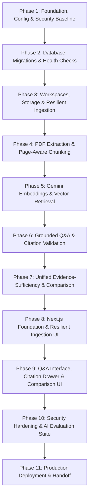

# ProofLens AI — Implementation Plan

**Document ID:** PLAI-IMP-001  
**Version:** 1.3 — Phased Implementation Roadmap (Production Hardened)  
**Governing PRD:** [ProofLens-AI-Project-Kickoff-PRD-v0.1.md](file:///Users/apple/Documents/Projects/ProofLense-AI/ProofLens-AI-Project-Kickoff-PRD-v0.1.md)  
**Technical Design:** [docs/TECHNICAL-DESIGN.md](file:///Users/apple/Documents/Projects/ProofLense-AI/docs/TECHNICAL-DESIGN.md)  
**Operating Guidelines:** [AGENTS.md](file:///Users/apple/Documents/Projects/ProofLense-AI/AGENTS.md)  
**Status:** Under Review (Pre-Implementation Baseline)

---

## 1. Plan Overview & Execution Principles

This implementation plan provides a structured, dependency-aware blueprint for engineering ProofLens AI. Implementation is broken into 11 discrete, verifiable phases designed for incremental execution in Google Antigravity.

### Core Disciplines
1. **Zero Secret Leaks:** Never read real `.env` files or hardcode credentials. Backend secrets (`GEMINI_API_KEY`, `DATABASE_URL`, `SUPABASE_SERVICE_ROLE_KEY`, `DEMO_ACCESS_TOKEN`) remain exclusively on the server.
2. **Current Planned Models & Account Verification:** Adopt `gemini-3.8-flash` for answer generation and `gemini-embedding-2` (768 dimensions) for embeddings based on official Google API architectural guidelines. Full account-level verification (quotas, billing tier, regional access) is performed during implementation integration tests using user-provided environment settings.
3. **Fail-Closed Production Security:** Public production deployments require a valid `DEMO_ACCESS_TOKEN` and HTTPS; unauthenticated mode is restricted exclusively to local development and tests.
4. **Resilient Data Lifecycle:** Atomic worker claiming, timeout-based recovery, idempotent retries, duplicate content hashing, and safe two-step deletion.
5. **Phase Completion Gates:** No phase begins until the preceding phase's tests pass and acceptance criteria are satisfied.
6. **No Phantom Claims:** Never claim a test or build succeeded without running the command and inspecting the output.
7. **Measurable Targets vs. Guarantees:** Distinguish deterministic structural invariants (e.g., 100% server-verified citation IDs) from empirical targets evaluated via benchmarks (e.g., retrieval recall and abstention accuracy).
8. **Clear Taxonomy:** Every task and decision is marked with **[PRD Requirement]**, **[Technical Recommendation]**, **[Open Decision]**, or **[Future Enhancement]**.

---

## 2. Phased Implementation Roadmap

---

### Phase 1: Project Foundation, Configuration & Security Baseline
- **Objective:** Establish the Python backend workspace, virtual environment, dependency specifications, Pydantic settings management, structured logging, CORS, passkey security middleware, and in-memory rate limiting.
- **Scope:** Backend folder scaffolding, `pyproject.toml` / `requirements.txt`, `app/core/config.py`, `app/core/logging.py`, `app/core/security.py`, in-memory rate limiting middleware, and basic Pytest configuration.
- **Exclusions:** Database connections, external API calls, frontend scaffolding.
- **Dependencies & Prerequisites:** Python 3.11+ installed; review of [AGENTS.md](file:///Users/apple/Documents/Projects/ProofLense-AI/AGENTS.md) and [.env.example](file:///Users/apple/Documents/Projects/ProofLense-AI/.env.example).
- **Expected Deliverables:**
  - `backend/pyproject.toml` or `backend/requirements.txt`
  - `backend/app/core/config.py` (**[PRD Requirement]** Pydantic `BaseSettings` with strict startup validation, supporting `GEMINI_GENERATION_MODEL=gemini-3.8-flash`, `GEMINI_EMBEDDING_MODEL=gemini-embedding-2`, `EMBEDDING_DIMENSIONS=768`, `RAG_MIN_SIMILARITY_THRESHOLD=0.65`, `DOCUMENT_PROCESSING_TIMEOUT_SECONDS=600`, and `DEMO_ACCESS_TOKEN`)
  - `backend/app/core/security.py` (Constant-time passkey validation middleware `deps.verify_access_passkey` using `secrets.compare_digest`)
  - `backend/app/core/logging.py` (Structured JSON logger redacting document content and credentials)
  - `backend/app/main.py` (Minimal FastAPI application with CORS middleware and rate limiting)
  - `backend/tests/unit/test_config.py` & `backend/tests/unit/test_security.py`
- **Files/Modules to Create:**
  - `backend/app/core/config.py`
  - `backend/app/core/logging.py`
  - `backend/app/core/security.py`
  - `backend/app/main.py`
  - `backend/tests/conftest.py`
  - `backend/tests/unit/test_config.py`
  - `backend/tests/unit/test_security.py`
- **Acceptance Criteria:**
  - Backend initializes without runtime errors using default development settings.
  - Startup fails immediately with clear error if required settings (like `DATABASE_URL` or `GEMINI_API_KEY`) are missing.
  - In production (`ENVIRONMENT=production`), startup **fails closed** if `DEMO_ACCESS_TOKEN` is missing, empty, or shorter than 16 characters.
  - When `DEMO_ACCESS_TOKEN` is configured, requests without valid `X-Workspace-Key` header receive HTTP 401 Unauthorized.
  - Unit tests execute using dummy test configuration without requiring real external API keys or live cloud access.
  - Rate limiting is documented as a local per-instance throttling heuristic, noting that per-instance counters reset on restart and do not provide distributed billing guarantees without a shared store.
- **Validation Commands:**
  - `pytest tests/unit/test_config.py tests/unit/test_security.py`
  - `uvicorn app.main:app --port 8000` -> `curl http://localhost:8000/docs`
- **Risks & Open Decisions:** None.
- **Completion Gate:** Configuration loads cleanly, test suite executes, passkey security middleware functions, and FastAPI OpenAPI documentation is accessible at `/docs`.

---

### Phase 2: Database Architecture, Migrations & Health Checks
- **Objective:** Configure asynchronous SQLAlchemy engine, define core models with foreign-key cascades and tombstone citations, initialize Alembic migrations, verify `pgvector` extension with 768-dimension vectors, implement startup vector dimension compatibility check, and expose health check probes.
- **Scope:** PostgreSQL connection management, Alembic migration scripts, `workspaces`, `documents` (with SHA-256 `content_hash` and recovery fields), `document_pages`, `document_chunks` (with `VECTOR(768)` and `embedding_model` metadata), `citations` (with `chunk_id UUID REFERENCES document_chunks(id) ON DELETE SET NULL` and historical snapshot fields `document_filename`, `page_number`, `quoted_snippet`), `/health/live` and `/health/ready` endpoints.
- **Exclusions:** Chunking, AI API calls, complex query routing.
- **Dependencies & Prerequisites:** Phase 1 complete; local PostgreSQL running with `pgvector` enabled (via Docker or local service).
- **Expected Deliverables:**
  - `backend/app/core/database.py` (Async session factory & Base model)
  - `backend/app/core/lifespan.py` (Startup vector dimension compatibility validator checking `pg_attribute` against `EMBEDDING_DIMENSIONS`)
  - `backend/alembic/` configuration & initial migration revision with `VECTOR(768)`
  - `backend/app/api/v1/health.py` (`/health/live` and `/health/ready` endpoints)
  - `backend/tests/integration/test_health.py` & `backend/tests/integration/test_schema_compatibility.py`
- **Files/Modules to Create:**
  - `backend/app/core/database.py`
  - `backend/app/core/lifespan.py`
  - `backend/app/models/base.py`
  - `backend/app/models/workspace.py`
  - `backend/app/models/document.py`
  - `backend/app/models/page.py`
  - `backend/app/models/chunk.py`
  - `backend/app/models/citation.py`
  - `backend/app/api/v1/health.py`
  - `backend/alembic/env.py`
  - `backend/tests/integration/test_health.py`
  - `backend/tests/integration/test_schema_compatibility.py`
- **Acceptance Criteria:**
  - Alembic executes `alembic upgrade head` cleanly against PostgreSQL.
  - Startup check aborts application launch if database vector column dimension does not match `settings.EMBEDDING_DIMENSIONS`.
  - `citations` table foreign key to `document_chunks` is configured with `ON DELETE SET NULL`, and schema includes historical snapshot columns (`document_filename`, `page_number`, `quoted_snippet`).
  - `GET /health/live` returns HTTP 200 `{"status": "alive"}` without requiring authentication.
  - `GET /health/ready` performs `SELECT 1;` and returns HTTP 200 with `{"database": "connected", "pgvector": true}` without requiring authentication.
- **Validation Commands:**
  - `alembic upgrade head`
  - `pytest tests/integration/test_health.py tests/integration/test_schema_compatibility.py`
- **Risks & Open Decisions:** Ensure local PostgreSQL instance has `vector` extension installed (`CREATE EXTENSION IF NOT EXISTS vector;`).
- **Completion Gate:** Database migrations apply successfully, dimension compatibility check passes, and health endpoints pass integration tests.

---

### Phase 3: Workspaces, Storage & Resilient Ingestion APIs
- **Objective:** Implement CRUD endpoints for workspaces, server-side streaming upload limits, PDF magic-byte checks, SHA-256 duplicate detection with database uniqueness defense, storage abstraction, atomic worker claiming, startup recovery watchdog, manual retry endpoint, safe two-step deletion, and workspace scope validation.
- **Scope:** Workspace create/list/get/delete, document upload with streaming byte limits ($\le 10\text{ MB}$) and magic bytes (`%PDF-`), SHA-256 check (409 Conflict on duplicates), startup recovery sweeper (`RecoveryWatchdog`), retry endpoint (`POST /api/v1/workspaces/{id}/documents/{doc_id}/retry`), safe two-step deletion (row lock, DB cascade commit, physical storage purge, orphan logging).
- **Exclusions:** PDF text extraction and embedding generation (handled in Phases 4 & 5).
- **Dependencies & Prerequisites:** Phase 2 complete.
- **Expected Deliverables:**
  - `backend/app/services/storage/base.py` & `local.py`
  - `backend/app/services/recovery/watchdog.py` (Interrupted task recovery & timeout sweeper)
  - `backend/app/schemas/workspace.py` & `document.py`
  - `backend/app/repositories/workspace_repo.py` & `document_repo.py`
  - `backend/app/api/v1/workspaces.py` & `documents.py` (Protected by `deps.verify_access_passkey`)
  - Integration tests for passkey enforcement, streaming size abort, magic-byte validation, duplicate upload race handling, cross-workspace scope isolation, restart recovery, and safe deletion.
- **Files/Modules to Create:**
  - `backend/app/services/storage/base.py`
  - `backend/app/services/storage/local.py`
  - `backend/app/services/recovery/watchdog.py`
  - `backend/app/schemas/workspace.py`
  - `backend/app/schemas/document.py`
  - `backend/app/repositories/workspace_repo.py`
  - `backend/app/repositories/document_repo.py`
  - `backend/app/api/v1/workspaces.py`
  - `backend/app/api/v1/documents.py`
  - `backend/tests/integration/test_workspaces_documents.py`
- **Acceptance Criteria:**
  - All workspace and document endpoints reject unauthenticated requests when passkey is enabled.
  - Streaming upload aborts immediately at $>10\text{ MB}$ with HTTP 413, without reading the full body into memory.
  - Non-PDF files without `%PDF-` magic bytes are rejected with HTTP 400 Bad Request.
  - Uploading an identical PDF twice returns `HTTP 409 Conflict` with `DUPLICATE_DOCUMENT` code and cleans up the temporary storage file.
  - Concurrent duplicate upload attempts are caught by `uq_workspace_content_hash` and translated cleanly to HTTP 409.
  - Accessing a valid document ID with a mismatched workspace ID returns HTTP 404 Not Found.
  - Deleting a document locks the row, commits database cascade, and purges the physical file; failed storage deletion logs an orphaned file entry without rolling back the DB deletion.
  - Document deletion sets `citations.chunk_id = NULL` on related citations while preserving answer text and citation tombstone metadata (`[Document purged]`).
  - Interrupted documents exceeding `DOCUMENT_PROCESSING_TIMEOUT_SECONDS` (600s) are safely transitioned from `processing` to `failed` by the startup watchdog.
- **Validation Commands:**
  - `pytest tests/integration/test_workspaces_documents.py`
- **Risks & Open Decisions:** File cleanup on database failure (must delete physical file if DB transaction aborts).
- **Completion Gate:** Ingestion APIs, lifecycle recovery mechanisms, and safe deletion pass all unit and integration tests.

---

### Phase 4: PDF Extraction & Page-Aware Chunking Pipeline
- **Objective:** Implement page-by-page PDF text extraction using `pypdf`, preserve physical page provenance, handle corrupt/empty/scanned PDFs gracefully, and generate page-bounded chunks.
- **Scope:** PDF text parser, empty page detection, character count validation, page-bounded text chunker (1000 characters, 200 overlap), persistence of `document_pages` and `document_chunks`.
- **Exclusions:** Gemini embedding generation (Phase 5).
- **Dependencies & Prerequisites:** Phase 3 complete.
- **Expected Deliverables:**
  - `backend/app/services/parsing/pdf_parser.py` (**[PRD Requirement]** Page-aware text extraction)
  - `backend/app/services/parsing/chunker.py` (**[PRD Requirement]** Page-bounded chunking: chunks strictly prohibited from crossing physical page boundaries)
  - Unit tests verifying that chunks never cross page boundaries and preserve 1-indexed page numbering.
- **Files/Modules to Create:**
  - `backend/app/services/parsing/pdf_parser.py`
  - `backend/app/services/parsing/chunker.py`
  - `backend/tests/unit/test_pdf_parser.py`
  - `backend/tests/unit/test_chunker.py`
- **Acceptance Criteria:**
  - Multi-page PDF produces exact page count and extracts text per page.
  - Zero-text/scanned PDFs fail with clear error message: `"Document appears to be scanned or contains no extractable text (OCR not supported in MVP)"`.
  - Every created chunk maintains valid `document_id`, `page_id`, and `page_number`.
  - No chunk spans across two physical pages.
- **Validation Commands:**
  - `pytest tests/unit/test_pdf_parser.py tests/unit/test_chunker.py`
- **Risks & Open Decisions:** Handling complex PDF encodings (ensure fallback encoding detection in `pypdf`).
- **Completion Gate:** Parsing and chunking unit tests pass on real sample PDFs, preserving page numbers across all chunks.

---

### Phase 5: Gemini Embeddings & pgvector Semantic Retrieval
- **Objective:** Integrate Google GenAI SDK for `gemini-embedding-2` configured to 768 output dimensions, verify account API access and quotas during live testing, batch generate embeddings, persist in `document_chunks`, build HNSW index, implement non-destructive re-embedding migration management script with post-cutover rollback, and execute cosine similarity searches.
- **Scope:** Gemini API embedding client, batching logic with retries/timeouts, pgvector HNSW index creation (`vector_cosine_ops`), re-embedding CLI management tool, semantic search repository querying by `workspace_id`.
- **Exclusions:** Answer generation (Phase 6).
- **Dependencies & Prerequisites:** Phase 4 complete; valid `GEMINI_API_KEY` configured locally in `.env`.
- **Expected Deliverables:**
  - `backend/app/services/ai/client.py` & `embedding.py` (`gemini-embedding-2`, `output_dimensionality=768`)
  - `backend/app/services/ai/reembed_chunks.py` (CLI management script supporting non-destructive cutover, soak window, and rollback)
  - `backend/app/repositories/chunk_repo.py` (Vector cosine distance queries using `<=>` scoped to workspace)
  - Alembic migration for HNSW index on `document_chunks.embedding`
  - Integration test verifying semantic retrieval returns relevant chunks for sample queries and verifying account quotas.
- **Files/Modules to Create:**
  - `backend/app/services/ai/client.py`
  - `backend/app/services/ai/embedding.py`
  - `backend/app/services/ai/reembed_chunks.py`
  - `backend/app/repositories/chunk_repo.py`
  - `backend/alembic/versions/xxxx_add_hnsw_vector_index.py`
  - `backend/tests/integration/test_vector_retrieval.py`
- **Acceptance Criteria:**
  - Text chunks generate valid 768-dimension float vectors using `gemini-embedding-2`.
  - Account-level API connectivity, rate limits (RPM/TPM), and embedding dimensions are verified against the configured Google AI Studio account.
  - Chunk queries return candidates ordered by cosine similarity within the specified workspace.
  - HNSW similarity scan completes in $<100\text{ ms}$ on indexed tables.
  - Re-embedding script safely populates new vector columns in rate-limited batches, renames columns non-destructively, preserves `old_embedding` during soak window, and supports instant post-cutover rollback.
- **Validation Commands:**
  - `pytest tests/integration/test_vector_retrieval.py`
- **Risks & Open Decisions:** Rate limits on free-tier Gemini API keys; implement exponential backoff (`tenacity`) with configurable retry limits.
- **Completion Gate:** Vector embeddings are stored and retrieved successfully from `pgvector` with passing integration tests.

---

### Phase 6: Grounded Q&A & Server-Authoritative Citation Validation
- **Objective:** Implement evidence-grounded answer generation using `gemini-3.8-flash` with Structured Outputs, verify account generation access, implement server-authoritative citation validation, snapshot tombstone creation, XML context framing, rate limiting, and query logging.
- **Scope:** XML `<evidence_context>` prompt construction, Pydantic structured output schema enforcement, passkey enforcement, rate limiting (`RATE_LIMIT_QUERIES_PER_MINUTE=20`), server-side citation validation (verifying chunk existence in DB candidate set and populating ground-truth page numbers and snapshot columns), query and citation persistence.
- **Exclusions:** Multi-document comparison (Phase 7).
- **Dependencies & Prerequisites:** Phase 5 complete.
- **Expected Deliverables:**
  - `backend/app/services/ai/generator.py` (`gemini-3.8-flash` structured answer synthesis)
  - `backend/app/services/rag/validator.py` (**[PRD Requirement]** Server-authoritative citation verification)
  - `backend/app/services/rag/orchestrator.py` (Full RAG coordination loop)
  - `backend/app/api/v1/queries.py` (Protected by `deps.verify_access_passkey`)
  - Tests verifying citation verification passes valid citations, persists snapshot fields (`document_filename`, `page_number`, `quoted_snippet`), and strips hallucinated IDs.
- **Files/Modules to Create:**
  - `backend/app/services/ai/generator.py`
  - `backend/app/services/rag/validator.py`
  - `backend/app/services/rag/orchestrator.py`
  - `backend/app/models/query.py`
  - `backend/app/models/answer.py`
  - `backend/app/models/citation.py`
  - `backend/app/api/v1/queries.py`
  - `backend/tests/unit/test_citation_validator.py`
  - `backend/tests/integration/test_rag_pipeline.py`
- **Acceptance Criteria:**
  - Answer response includes verified citations mapping to real document IDs, filenames, and page numbers.
  - 100% of generated citation IDs match actual retrieved candidate chunks (server strips hallucinated IDs).
  - Model cannot hallucinate page numbers; page numbers in the API response are populated directly from PostgreSQL.
  - Rate limiting blocks requests exceeding `RATE_LIMIT_QUERIES_PER_MINUTE` with HTTP 429 on a per-worker basis.
  - Query runs, answers, citations (with snapshot fields), and retrieved evidence are persisted to the database.
- **Validation Commands:**
  - `pytest tests/unit/test_citation_validator.py tests/integration/test_rag_pipeline.py`
- **Risks & Open Decisions:** Explicitly distinguish structural citation validity from semantic claim entailment; document that structural integrity is verified deterministically while claim entailment is evaluated via benchmarks.
- **Completion Gate:** End-to-end question answering functions reliably with server-verified citations and snapshot tombstones.

---

### Phase 7: Unified Evidence-Sufficiency Policy & Cross-Document Comparison
- **Objective:** Implement the unified two-stage evidence-sufficiency policy (`RAG_MIN_SIMILARITY_THRESHOLD=0.65`) and cross-document comparative analysis across selected documents.
- **Scope:** Unified thresholding logic in `abstention.py` (deterministic vector abstention when top score $< 0.65$; semantic content abstention via LLM `is_abstention`), passkey-protected cross-document comparison service, `/api/v1/workspaces/{id}/comparisons` endpoint.
- **Exclusions:** Frontend UI implementation.
- **Dependencies & Prerequisites:** Phase 6 complete.
- **Expected Deliverables:**
  - `backend/app/services/rag/abstention.py` (**[PRD Requirement]** Unified evidence sufficiency & abstention engine)
  - `backend/app/services/comparison/comparator.py` (**[PRD Requirement]** Cross-document comparison engine)
  - `backend/app/api/v1/comparisons.py` (Protected by `deps.verify_access_passkey`)
  - Unit and integration tests for abstention and comparison.
- **Files/Modules to Create:**
  - `backend/app/services/rag/abstention.py`
  - `backend/app/services/comparison/comparator.py`
  - `backend/app/models/comparison.py`
  - `backend/app/schemas/comparison.py`
  - `backend/app/api/v1/comparisons.py`
  - `backend/tests/unit/test_abstention.py`
  - `backend/tests/integration/test_comparisons.py`
- **Acceptance Criteria:**
  - Queries with top similarity score below `RAG_MIN_SIMILARITY_THRESHOLD` immediately return `status: 'insufficient_evidence'` without calling Gemini.
  - Questions where evidence does not address the question return semantic abstention (`status: 'insufficient_evidence'`).
  - Multi-document comparison returns per-document findings, citations, synthesis, and limitation notes.
- **Validation Commands:**
  - `pytest tests/unit/test_abstention.py tests/integration/test_comparisons.py`
- **Risks & Open Decisions:** Calibrate default threshold (0.65) using the evaluation harness in Phase 10.
- **Completion Gate:** Abstention and cross-document comparison endpoints fully functional with automated tests passing.

---

### Phase 8: Next.js Foundation, Resilient Ingestion & Passkey UI
- **Objective:** Initialize the Next.js frontend with TypeScript and Vanilla CSS tokens, build workspace navigation, document upload dropzone with duplicate handling, processing status indicators, retry buttons, and access passkey modal.
- **Scope:** Root layout, design tokens, workspace selector, document library, duplicate upload conflict banner (409), document retry action, status polling (`processing` -> `ready` / `failed`), passkey modal injecting `X-Workspace-Key` header into client API wrapper.
- **Exclusions:** Q&A chat and citation viewer (Phase 9).
- **Dependencies & Prerequisites:** Phase 3 & 4 backend endpoints working and accessible.
- **Expected Deliverables:**
  - Next.js 14+ project initialized in `frontend/`
  - Design token system in `frontend/src/styles/tokens.css`
  - API client wrapper in `frontend/src/lib/api/client.ts` with `X-Workspace-Key` header injection and global 401 interceptor
  - `DocumentUploadDropzone.tsx`, `DocumentList.tsx`, `WorkspaceCard.tsx`, `PasskeyModal.tsx`
  - Component unit tests.
- **Files/Modules to Create:**
  - `frontend/src/styles/tokens.css`
  - `frontend/src/styles/globals.css`
  - `frontend/src/lib/api/client.ts`
  - `frontend/src/lib/api/workspaces.ts`
  - `frontend/src/lib/api/documents.ts`
  - `frontend/src/components/documents/DocumentUploadDropzone.tsx`
  - `frontend/src/components/documents/DocumentList.tsx`
  - `frontend/src/components/common/PasskeyModal.tsx`
  - `frontend/src/app/workspaces/[workspaceId]/page.tsx`
- **Acceptance Criteria:**
  - Clean, responsive UI with accessible typography and polished aesthetics.
  - File uploader validates size ($\le 10\text{ MB}$) and type (`.pdf`) before transmission.
  - Duplicate uploads display actionable conflict alert linking to the existing file.
  - Failed or timed-out documents render a "Retry" button that re-triggers ingestion.
  - Missing passkey prompts the user via modal and persists token in session storage.
- **Validation Commands:**
  - `npm run build`
  - `npm run lint`
- **Risks & Open Decisions:** Ensure Vanilla CSS tokens provide cohesive contrast without bloated third-party CSS libraries.
- **Completion Gate:** Frontend builds cleanly; user can create workspaces, manage passkeys, and upload PDFs with visible status transitions.

---

### Phase 9: Q&A Interface, Citation Drawer & Cross-Document Comparison UI
- **Objective:** Build the interactive Q&A interface, citation badges with tombstone support, slide-over evidence inspection panel, insufficient-evidence indicator, and cross-document comparison view.
- **Scope:** `QuestionInput.tsx`, `AnswerCard.tsx`, `CitationPill.tsx` (handling active citations and `[Document purged]` tombstones), `EvidenceDrawer.tsx`, `InsufficientEvidenceView.tsx`, and `ComparisonMatrix.tsx`.
- **Exclusions:** AI evaluation UI (Phase 10).
- **Dependencies & Prerequisites:** Phase 6 & 7 backend endpoints working; Phase 8 frontend components built.
- **Expected Deliverables:**
  - Interactive Q&A thread with loading spinners and keyboard shortcuts (Enter to send).
  - Citation badges that open the slide-over `EvidenceDrawer` with the cited page excerpt when active, or render a disabled `[Document purged]` tombstone when `chunk_id IS NULL`.
  - Prominent visual rendering of abstention responses.
  - Dedicated `/workspaces/[workspaceId]/compare` page with document selector and comparison matrix.
- **Files/Modules to Create:**
  - `frontend/src/components/qa/QuestionInput.tsx`
  - `frontend/src/components/qa/AnswerCard.tsx`
  - `frontend/src/components/qa/CitationPill.tsx`
  - `frontend/src/components/qa/EvidenceDrawer.tsx`
  - `frontend/src/components/qa/InsufficientEvidenceView.tsx`
  - `frontend/src/components/compare/DocumentSelector.tsx`
  - `frontend/src/components/compare/ComparisonMatrix.tsx`
  - `frontend/src/app/workspaces/[workspaceId]/compare/page.tsx`
- **Acceptance Criteria:**
  - Submitting a question returns a grounded answer with clickable citations.
  - Clicking an active citation opens the exact source excerpt and verified page number in the drawer.
  - Purged citations render clearly as `[Document purged: filename, p. X]` without breaking the UI.
  - Insufficient evidence displays a distinct, non-error abstention banner.
  - Multi-document comparison renders side-by-side claim summaries with per-document citations.
- **Validation Commands:**
  - `npm run build`
  - End-to-end verification in browser.
- **Risks & Open Decisions:** Responsive layout on mobile screens (ensure drawer transitions into full-width modal).
- **Completion Gate:** Full interactive user flow demonstrable in the browser without UI bugs.

---

### Phase 10: Security Hardening & AI Evaluation Suite
- **Objective:** Implement adversarial prompt-injection tests, safe logging checks, parameter sweep evaluation for `RAG_MIN_SIMILARITY_THRESHOLD`, and the reproducible AI evaluation benchmark harness (`tests/eval/curated_benchmark.json`).
- **Scope:** Prompt sanitizer, structured JSON logger (redacting document text and PII), benchmark runner script (`python -m app.services.evaluation.runner`), threshold sweep analysis.
- **Exclusions:** Production cloud provisioning.
- **Dependencies & Prerequisites:** Phase 6 & 7 backend complete.
- **Expected Deliverables:**
  - `backend/tests/eval/curated_benchmark.json` (25 curated evaluation queries: 10 factual, 5 comparison, 10 negative out-of-scope)
  - `backend/app/services/evaluation/runner.py` (CLI benchmark execution tool reporting per-category metrics)
  - `backend/tests/eval/test_adversarial_prompts.py` (Empirical testing of XML context framing against injection)
  - Benchmark run outputting Retrieval Hit Rate, Structural Citation Validity, Abstention Accuracy, and Exploratory Semantic Support.
- **Files/Modules to Create:**
  - `backend/tests/eval/curated_benchmark.json`
  - `backend/app/services/evaluation/runner.py`
  - `backend/app/core/security.py`
  - `backend/tests/eval/test_adversarial_prompts.py`
- **Acceptance Criteria:**
  - Benchmark runs via a single CLI command and prints structured per-category results.
  - Structural Citation Validity Rate achieves **100%** (zero hallucinated citations).
  - Out-of-scope negative queries achieve **$\ge 90\%$** abstention accuracy.
  - Retrieval Hit Rate (Recall@5) achieves **$\ge 85\%$** on curated factual test set.
  - False Abstention Rate on factual set is **$\le 10\%$**.
  - Comparison Quality achieves **$\ge 80\%$** on comparison cases.
  - Adversarial prompt injection samples fail to break system instructions ($\ge 90\%$).
  - Stage-level latencies conform to P95 targets (total $< 2500\text{ ms}$).
- **Validation Commands:**
  - `python -m app.services.evaluation.runner`
  - `pytest tests/eval/`
- **Risks & Open Decisions:** Note that `temperature=0.0` reduces variance but does not guarantee 100% deterministic external-model output.
- **Completion Gate:** Evaluation suite executes reproducibly and demonstrates evidence-first fidelity.

---

### Phase 11: Production Deployment Preparation & Handoff
- **Objective:** Finalize deployment configurations for Render (backend), Vercel (frontend), and Supabase (database and storage); document setup guides, fail-closed production verification, and operations runbooks.
- **Scope:** Review and verify configuration against `.env.production.example`, document Supabase database setup steps (pgvector extension), Render service configuration, Vercel build settings, passkey configuration, and orphan storage reconciliation.
- **Exclusions:** Automatic cloud provisioning or committing real secrets.
- **Dependencies & Prerequisites:** All previous phases tested and passing locally.
- **Expected Deliverables:**
  - `docs/DEPLOYMENT-GUIDE.md` (Step-by-step instructions for Render, Vercel, and Supabase)
  - `docs/OPERATIONS-RUNBOOK.md` (Monitoring, health checks, migration procedures, rollback steps, orphan cleanup)
  - Production readiness checklist.
- **Files/Modules to Create:**
  - `docs/DEPLOYMENT-GUIDE.md`
  - `docs/OPERATIONS-RUNBOOK.md`
- **Acceptance Criteria:**
  - Another developer can deploy the application using the documented guide without undocumented steps.
  - Production deployment fails closed if `DEMO_ACCESS_TOKEN` is missing or invalid.
  - Verified separation: zero backend secrets exist in frontend environment templates or bundles.
- **Validation Commands:**
  - Final full-suite local validation: `pytest` and `npm run build`.
- **Risks & Open Decisions:** Confirming final cloud resource regions (Render and Supabase in same region, e.g. AWS us-east-1, to minimize network latency).
- **Completion Gate:** System is 100% demo-ready, documented, tested, and primed for deployment.

---

## 3. Risk Management & Mitigation Matrix

| Identified Risk | Severity | Mitigation Strategy | Phase Addressed |
| :--- | :--- | :--- | :--- |
| **Model Hallucinates Citations** | Critical | Server-authoritative validation strips any citation ID not in the database candidate set; page numbers are extracted directly from PostgreSQL records. | Phase 6 |
| **Prompt Injection via PDFs** | High | XML delimiter tagging (`<evidence_context>`); explicit instruction anchoring; continuous adversarial testing in `tests/eval/`. Treated as a mitigation requiring evaluation. | Phase 6, 10 |
| **Scanned Image PDFs Yield No Text** | Medium | Character-count validation immediately flags scanned PDFs with a clear error explaining OCR is post-MVP. | Phase 4 |
| **Transient Gemini API Outages / Limits** | Medium | Exponential backoff retries (`tenacity`) and strict timeout policies (30s local, 45s prod). | Phase 5, 6 |
| **Duplicate Uploads & Wasted Compute** | Medium | SHA-256 content hashing with database unique constraint blocks duplicate uploads within a workspace with HTTP 409 Conflict. | Phase 3, 8 |
| **Interrupted Background Tasks** | Medium | Startup lifespan recovery sweeper and staleness watchdog mark stalled tasks as failed with retry action. | Phase 3, 8 |
| **Storage Orphan Leakage on Deletion** | Medium | Safe two-step deletion: database cascade committed first, followed by physical storage purge with orphan logging. | Phase 3 |
| **Public Deployment Resource Abuse** | High | Passkey Gatekeeper (`DEMO_ACCESS_TOKEN` / `X-Workspace-Key`) with fail-closed production startup validation. In-memory rate limiting applied locally. | Phase 1, 8, 11 |
| **Silent Vector Dimension Mismatch** | High | Startup schema compatibility check verifies database column dimension against `EMBEDDING_DIMENSIONS`. | Phase 2, 5 |
| **Vector Migration Failure Post-Cutover** | High | Non-destructive migration retains `old_embedding` during soak window, enabling instant rollback if issues appear. | Phase 5 |
| **Secret Leaks in Client Bundles** | Critical | Enforce [AGENTS.md](file:///Users/apple/Documents/Projects/ProofLense-AI/AGENTS.md) Rule Zero; only public URLs use `NEXT_PUBLIC_*`; backend secrets kept exclusively on Render. | Phase 1, 11 |

---

## 4. Deferred Post-MVP Features (Strictly Excluded from MVP Baseline)

The following capabilities are categorized as **[Future Enhancement]** and must not block or complicate the delivery of the 11 MVP phases:

1. **Claim-by-Claim Natural Language Inference (NLI) Verification**
2. **Hybrid BM25 Keyword + Vector Search (Reciprocal Rank Fusion)**
3. **Optical Character Recognition (OCR) for Scanned Documents**
4. **Table Structure Extraction (Camelot / Tabula)**
5. **Multi-Tenant User Accounts & Team Workspaces (Supabase Auth / JWT)**
6. **Persistent Distributed Message Queues (Celery / Redis / SQS)**
7. **Export Research Report to PDF / Markdown**
8. **Document Revision & Diff Comparison**
