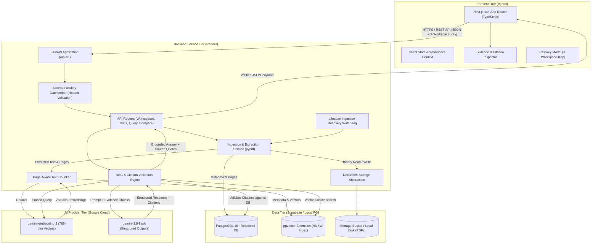
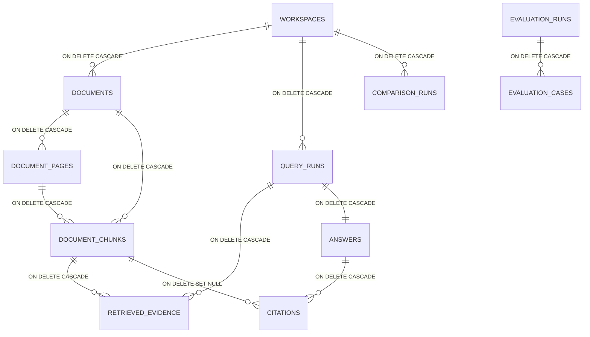
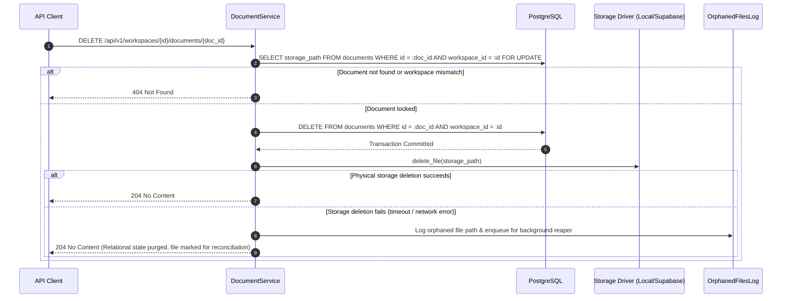

# ProofLens AI — Technical Design Document

**Document ID:** PLAI-TDD-001  
**Version:** 1.3 — Architecture Baseline (Production Hardened)  
**Governing PRD:** [ProofLens-AI-Project-Kickoff-PRD-v0.1.md](file:///Users/apple/Documents/Projects/ProofLense-AI/ProofLens-AI-Project-Kickoff-PRD-v0.1.md)  
**Operating Guidelines:** [AGENTS.md](file:///Users/apple/Documents/Projects/ProofLense-AI/AGENTS.md)  
**Status:** Under Review (Pre-Implementation Architecture Baseline)

---

## Document Taxonomy & Legend

To preserve strict traceability to the project brief and maintain architectural discipline, every requirement, design choice, and capability in this document is labeled with one of four classifications:

- **[PRD Requirement]**: Mandatory capability, boundary, or principle explicitly mandated by `ProofLens-AI-Project-Kickoff-PRD-v0.1.md`.
- **[Technical Recommendation]**: Engineering proposal selected to implement PRD requirements cleanly, securely, and maintainably.
- **[Open Decision]**: Architectural or operational item requiring confirmation from the project owner before execution.
- **[Future Enhancement]**: Valuable feature strictly deferred beyond the MVP release.

---

## 1. Product Scope and System Architecture

### 1.1 Product Summary & MVP Boundaries
**[PRD Requirement]** ProofLens AI is an evidence-first document intelligence platform built around the core value proposition: *From Documents to Verifiable Answers*. Users upload a curated set of PDF files to a workspace, ask natural language questions, receive concise answers strictly grounded in retrieved passages, inspect page-level supporting citations, and compare findings across multiple documents. Crucially, the system must detect when available documents lack supporting facts and return an explicit insufficient-evidence response rather than speculating.

#### In-Scope for MVP
1. **Workspace & Document Management:** Workspace creation, multi-PDF upload, metadata tracking, processing status, error reporting, and document deletion.
2. **Duplicate Upload Handling:** SHA-256 file hashing with database-enforced uniqueness constraints to detect and handle redundant uploads predictably within a workspace.
3. **Resilient Ingestion & Recovery:** Timeout-based staleness watchdog and startup recovery for interrupted tasks, coupled with idempotent retries and safe partial-extraction cleanup.
4. **PDF Parsing & Provenance Preservation:** Extraction of text with guaranteed page-level attribution (`document_id`, `filename`, `page_number`).
5. **Page-Bounded Chunking & Vector Storage:** Configurable text chunking strictly constrained within physical page boundaries and vector storage in PostgreSQL using `pgvector`.
6. **Vector Retrieval & Schema Compatibility:** Query embedding and cosine similarity search scoped strictly to the active workspace, with startup validation of vector dimensions.
7. **Grounded Question Answering:** Synthesis restricted strictly to retrieved context passages, outputting verifiable citations.
8. **Server-Authoritative Citation Validation:** Server-side verification matching generated citations against real retrieved chunk records; rejection or sanitization of hallucinated citations.
9. **Unified Evidence-Sufficiency Policy:** Two-stage evaluation combining deterministic vector-level abstention and semantic content-level abstention.
10. **Cross-Document Comparison:** Side-by-side or synthesized multi-document comparison highlighting evidence-backed agreements, divergences, and scope limitations.
11. **Initial Regression Evaluation Suite:** Reproducible 25-case CLI test harness measuring retrieval hit rate, structural citation validity, abstention behavior, and exploratory semantic support.
12. **End-to-End Public Demo Protection:** Complete application-level access control enforcing passkey validation on all sensitive operations, preventing unauthorized compute or storage consumption.

#### Exclusions for MVP (Non-Goals)
- **[PRD Requirement]** Autonomous agents executing arbitrary tool loops.
- **[PRD Requirement]** Multi-agent orchestration frameworks (e.g., LangGraph, AutoGen, CrewAI).
- **[PRD Requirement]** Foundation model fine-tuning or custom model training.
- **[PRD Requirement]** Guaranteed truth detection or claims of infallible AI verification.
- **[PRD Requirement]** Real-time web search or unrestricted external internet browsing.
- **[PRD Requirement]** Optical Character Recognition (OCR) for scanned image-only PDFs in Milestone 1–5.
- **[PRD Requirement]** Enterprise SSO, multi-tenant billing, or complex role-based access control (RBAC).

---

### 1.2 System Architecture Diagram



---

### 1.3 Core Component Responsibilities & Model Selection

#### AI Model Selection & Documentation Rationale (Pending Runtime Account Verification)
1. **Embedding Model: `gemini-embedding-2`** **[Technical Recommendation]**
   - *Status & Deprecation Context:* The legacy `text-embedding-004` model reached its official shutdown date on January 14, 2026. Official Google documentation designates `gemini-embedding-2` as the stable recommended replacement for text and multimodal vector generation.
   - *Specifications:* Input token window: 8,192 tokens. Output dimension size: flexible (supports 128 to 3072 dimensions).
   - *Selected Output Dimension:* Configured to **768 dimensions** (`output_dimensionality=768`) via environment variable `EMBEDDING_DIMENSIONS=768`. This preserves computational efficiency, keeps index memory modest on PostgreSQL, and aligns with standard pgvector benchmarks.
   - *API Invocation:* Calls official Google GenAI SDK `client.models.embed_content(model="gemini-embedding-2", contents=..., config=types.EmbedContentConfig(output_dimensionality=768))`.
2. **Generation Model: `gemini-3.8-flash`** **[Technical Recommendation]**
   - *Status & Availability Context:* Official Google API documentation explicitly notes:
     > *"To ensure reliable performance for everyone, we are limiting access to the 2.5 models to users who have actively used them in the past... For any new projects, use our latest models: 3.5 Flash-Lite or 3.8 Flash."*
   - Therefore, based on architectural guidance, we adopt `gemini-3.8-flash` as our primary planned generation engine (with `gemini-3.5-flash-lite` supported via configuration).
   - *Capabilities:* Native support for Structured Outputs via Pydantic schema validation (`response_mime_type="application/json"` and `response_schema=AnswerResponseSchema`), 1M token context window, low latency, and hybrid reasoning.
   - *Configuration:* Fully environment-driven via `GEMINI_GENERATION_MODEL=gemini-3.8-flash`.
3. **Explicit Distinction: Architectural Selection vs. Runtime Account Verification:**
   - *Important Boundary:* This documented model selection reflects official API specifications and architectural best practices. It does **not** constitute verification against the developer's specific Google AI Studio account, API key tier, rate limits (RPM/TPM), billing status (Free vs. Pay-As-You-Go), or regional model enablement.
   - Full account-level verification must be executed during implementation (Phase 1 connectivity and Phase 5/6 API integration) using live API credentials, without exposing secret keys in logs or source files.

#### Platform Infrastructure
- **Next.js (Frontend):** **[Technical Recommendation]** User interface, document upload dropzones, status polling, conversational threads, evidence inspection drawers, and cross-document comparison matrix. Strictly presentation logic; never accesses backend secrets or databases directly.
- **FastAPI (Backend):** **[PRD Requirement]** Enforces business logic, API validation via Pydantic v2, workspace isolation, PDF text extraction, chunking, embedding coordination, vector search orchestration, prompt assembly, and citation integrity checking.
- **PostgreSQL + `pgvector`:** **[PRD Requirement]** Relational application data and vector storage indexed with HNSW for sub-100ms cosine similarity searches.
- **Document Storage:**
  - *Local Development:* Local filesystem (`./data/uploads`).
  - *Production:* Supabase Storage bucket (`prooflens-documents`) via signed private URLs.

---

### 1.4 Access Control, Deployment Security & Fail-Closed Policy

#### Complete Public-Demo Access Control
**[Technical Recommendation]** Operating with `AUTH_ENABLED=false` on a public, unauthenticated cloud endpoint introduces critical risks: unauthorized PDF uploads, database storage exhaustion, uncontrolled Gemini API billing consumption, and malicious document deletion.

To eliminate this vulnerability without introducing premature enterprise multi-tenant authentication into the MVP baseline, the system implements a strict **Application-Level Access Passkey Gatekeeper**:

1. **Complete Endpoint Coverage:** Every sensitive API endpoint enforces passkey validation via dependency injection (`deps.verify_access_passkey`), including:
   - Workspace creation, listing, retrieval, and deletion (`POST /api/v1/workspaces`, `GET /api/v1/workspaces`, `DELETE /api/v1/workspaces/{id}`).
   - Document upload, listing, retrieval, status, retry, and deletion (`POST /api/v1/workspaces/{id}/documents/upload`, `GET /api/v1/workspaces/{id}/documents`, `POST .../retry`, `DELETE .../{doc_id}`).
   - Question answering and query execution (`POST /api/v1/workspaces/{id}/queries`).
   - Evidence chunk inspection and cross-document comparison (`POST /api/v1/workspaces/{id}/comparisons`, `GET .../chunks/{chunk_id}`).
   - Evaluation runner execution (`POST /api/v1/evaluations/run`).
   - *Exempt Endpoints:* Process liveness (`GET /health/live`) and readiness (`GET /health/ready`) probes remain unauthenticated to allow hosting platform orchestrators to monitor container health.
2. **Production Fail-Closed Guarantee:**
   - In production (`ENVIRONMENT=production`), the application startup logic strictly validates that `DEMO_ACCESS_TOKEN` is set, non-empty, and at least 16 characters long.
   - If `DEMO_ACCESS_TOKEN` is missing or invalid in production, **the backend immediately aborts startup with an actionable error**, preventing the exposure of an unauthenticated public API.
   - `AUTH_ENABLED=false` is strictly prohibited in production and rejected during startup validation. It is permitted solely in `development` and `test` environments.
3. **Constant-Time Validation & Security Guardrails:**
   - Client requests must supply the token in the HTTP header: `X-Workspace-Key: <token>`.
   - The backend validates the header using constant-time string comparison (`secrets.compare_digest`) to protect against timing attacks.
   - Failed authentication returns `HTTP 401 Unauthorized` with a standardized `ErrorResponse`.
   - The token is **never** logged in application logs, printed in error messages, or embedded in URLs.
   - `DEMO_ACCESS_TOKEN` is a backend secret and must **never** be prefixed with `NEXT_PUBLIC_*` or bundled into client-side code.
   - All public production traffic requires HTTPS.
4. **Rate Limits & In-Memory Counter Limitations:**
   - The backend includes in-memory rate limiting (via SlowAPI or custom ASGI middleware):
     - Query execution: `RATE_LIMIT_QUERIES_PER_MINUTE=20`.
     - Document upload: `RATE_LIMIT_UPLOADS_PER_HOUR=30`.
     - General API calls: `RATE_LIMIT_REQUESTS_PER_MINUTE=120`.
   - *Explicit Limitations of In-Memory Rate Limiting:*
     - **Per-Instance Counters:** In-memory limits are tracked locally inside process memory. Across multiple Gunicorn/Uvicorn worker processes or multiple horizontal Render container instances, counters are isolated. Total aggregate throughput across $N$ workers scales up by $N$.
     - **Reset on Restart:** In-memory counters reset to zero whenever processes recycle, workers crash, or deployments roll over.
     - **Distributed Enforcement Requirement:** True global abuse prevention and deterministic billing ceilings require an external shared store (e.g., Redis / Valkey) or API gateway edge metering (e.g., Cloudflare Rate Limiting).
     - **Operational Role:** In MVP, in-memory limits serve only as a local throttling heuristic against client-side double-submits and localized burst flooding. Hard billing limits must be configured directly within the Google AI Studio console budget controls and Render service plan settings.
5. **Workspace Scoping & Cross-Tenant Isolation:**
   - Passing authentication does **not** grant unrestricted access to arbitrary UUIDs.
   - Every operation explicitly validates workspace ownership and scope:
     `SELECT id FROM documents WHERE id = :doc_id AND workspace_id = :workspace_id`.
     Querying a valid document UUID with a mismatched workspace ID immediately returns `HTTP 404 Not Found`. Knowing or guessing a UUID never grants cross-workspace access.
6. **Edge Protection (Cloudflare / Vercel Integration):**
   - If an external gateway (Cloudflare Zero Trust / Vercel Deployment Protection) is enabled, the backend on Render must not remain exposed to public bypass.
   - The backend enforces the `DEMO_ACCESS_TOKEN` gatekeeper regardless of fronting proxies, ensuring complete end-to-end defense in depth.
7. **Documented Limitations of Shared Passkey:**
   - *Important Boundary:* A shared passkey is an operational gatekeeper against internet scraping, automated bot attacks, and denial-of-wallet resource exhaustion. It does **not** provide individual user identity, per-user data segregation, or cryptographic non-repudiation. Full multi-tenant user accounts with JWT/OAuth2 authentication remain documented as a post-MVP **[Future Enhancement]**.

---

## 2. Ingestion Lifecycle, Concurrency & Resilient Recovery

### 2.1 State Model & Job Classification
**[Technical Recommendation]**
To eliminate ambiguity during document ingestion, the system defines four discrete execution states:

```
[pending] ──(Claimed by worker)──► [processing] ──(Success)──► [ready]
                                        │
                                        └──(Failure / Timeout)──► [failed] ──(Retry)──► [processing]
```

1. **Newly Started Job:** An upload has been accepted; the record is inserted with `status = 'processing'`, `processing_started_at = NOW()`, and `processing_attempts = 1`.
2. **Actively Running Job:** An asynchronous background task is actively parsing pages or generating embeddings, with elapsed time well below `DOCUMENT_PROCESSING_TIMEOUT_SECONDS` (default: 600s / 10 minutes).
3. **Stale Job:** A document remaining in `status = 'processing'` whose elapsed time exceeds `DOCUMENT_PROCESSING_TIMEOUT_SECONDS` without updating its state.
4. **Interrupted Job:** A document that was actively processing when the backend process terminated (e.g., container restart, worker crash, or deployment rollover).

---

### 2.2 Concurrency Control & Atomic Worker Claiming
**[Technical Recommendation]**
In an environment with concurrent requests or background workers, multiple workers must never claim or process the same document simultaneously:
- **Atomic State Claiming:** When an ingestion job is triggered (upon initial upload or manual retry), the worker executes an atomic conditional update:
  ```sql
  UPDATE documents 
  SET status = 'processing', 
      processing_started_at = NOW(), 
      processing_attempts = processing_attempts + 1
  WHERE id = :document_id 
    AND workspace_id = :workspace_id 
    AND status IN ('pending', 'failed')
  RETURNING id;
  ```
- If the query returns zero rows, another worker has already claimed the job or the document is already `ready`. The duplicate execution attempt is aborted immediately.

---

### 2.3 Safe Startup Recovery & Lifespan Watchdog
**[Technical Recommendation]**
Indiscriminately marking every `processing` document as failed whenever the server starts causes state corruption during multi-worker restarts or horizontal scaling:
- **Startup Recovery Procedure (`RecoveryWatchdog`):**
  - During application startup in the FastAPI lifespan handler (`app/core/lifespan.py`), the watchdog inspects the database:
    ```sql
    SELECT id, filename, processing_started_at 
    FROM documents 
    WHERE status = 'processing' 
      AND processing_started_at < NOW() - INTERVAL '600 seconds';
    ```
  - **Only genuinely stale records** (where elapsed time exceeds `DOCUMENT_PROCESSING_TIMEOUT_SECONDS`) are transitioned to `failed`:
    ```sql
    UPDATE documents 
    SET status = 'failed', 
        error_message = 'Processing timed out or was interrupted by a server restart. Please retry.'
    WHERE status = 'processing' 
      AND processing_started_at < NOW() - INTERVAL '600 seconds';
    ```
  - Any `processing` record whose `processing_started_at` is recent ($< 600\text{ seconds}$) is left untouched to allow active concurrent workers to complete.
- **In-Process MVP Execution Limits:**
  - In MVP, background jobs run via FastAPI `BackgroundTasks`.
  - *Honest Operational Boundary:* In-process tasks run within the Python ASGI process memory. They do not survive physical container crashes or hard process termination. If Render restarts a container mid-ingestion, the task dies. The startup watchdog safely catches these interrupted tasks once their timeout window elapses and marks them `failed`, allowing the user to click "Retry". Persistent message brokers (e.g., Celery + Redis or SQS) are deferred as **[Future Enhancement]**.

---

### 2.4 Idempotent Retries & Partial-Extraction Cleanup
**[Technical Recommendation]**
If an ingestion job crashes midway (e.g., after parsing Page 3 of 10 or after embedding 12 of 30 chunks), repeated retries must never leave duplicate pages, chunks, or vectors in the database:
- **Transactional Atomic Replacement:**
  Before writing newly extracted pages or chunks, the retry task executes within an atomic database transaction:
  ```sql
  -- Purge all partial pages and chunks from previous failed runs
  DELETE FROM document_pages WHERE document_id = :document_id;
  DELETE FROM document_chunks WHERE document_id = :document_id;
  ```
- **Idempotent Retry Flow:**
  1. The user (or recovery system) invokes `POST /api/v1/workspaces/{id}/documents/{doc_id}/retry`.
  2. The endpoint verifies workspace ownership and checks that `status == 'failed'`.
  3. The document is claimed atomically (`status = 'processing'`).
  4. The background task reads the existing raw PDF from storage, executes the purge query above, and runs extraction, chunking, and embedding from scratch.
  5. Upon completion, new pages and chunks are committed and `status` transitions to `ready`.

---

### 2.5 Failure Edge Cases & Orphan Reconciliation
1. **Crash After Writing File, Before DB Record Creation:**
   - The file exists in storage under a UUID path, but no database row references it.
   - The upload endpoint wraps operations in a `try...except` block: if the database insert fails, `storage_service.delete_file(storage_path)` is called immediately in the exception handler.
   - An asynchronous administrative cleanup task can reconcile storage by comparing bucket files against `SELECT storage_path FROM documents`.
2. **Crash After Creating DB Record, Before Ingestion Finishes:**
   - The document remains in `status = 'processing'` until the `RecoveryWatchdog` catches it after 600 seconds, transitions it to `failed`, and enables the retry action in the UI.

---

## 3. Safe Deletion Semantics & Lifecycle Management

### 3.1 Relational Schema & Foreign-Key Constraints



---

### 3.2 Historical Query Results, Tombstone Citations & Retention Policy
**[PRD Requirement & Technical Recommendation]**
To resolve the contradiction between cascading deletion and preserving historical Q&A integrity, the system implements a **Snapshot Tombstone Citation Pattern**:

1. **Workspace Deletion:**
   - Deleting a workspace invokes `ON DELETE CASCADE` across all child tables (`documents`, `document_pages`, `document_chunks`, `query_runs`, `answers`, `citations`, `comparison_runs`).
   - This executes standard SQL row deletion (`DELETE`), permanently removing active application records from the database.
   - *Backup & Retention Clarification:* Ordinary database row deletion removes active records from relational tables. Disk storage recovery is managed by routine PostgreSQL `VACUUM`. Point-in-time database backups and Write-Ahead Logs (WAL) retain historical transaction data until expired according to standard cloud backup retention policies.
2. **Document Deletion within an Active Workspace:**
   - When an individual document is deleted:
     - Its `document_pages` and `document_chunks` are permanently deleted (`ON DELETE CASCADE`), ensuring all vector embeddings are expunged from future semantic searches.
     - `retrieved_evidence` join table entries are cascade-deleted (`ON DELETE CASCADE`).
     - In the `citations` table, the foreign key to `document_chunks` is configured as:
       `chunk_id UUID REFERENCES document_chunks(id) ON DELETE SET NULL`.
     - At answer creation time, each `citations` row persists an immutable historical snapshot:
       `document_filename VARCHAR(255) NOT NULL`, `page_number INTEGER NOT NULL`, `quoted_snippet TEXT NOT NULL`.
     - When the underlying `document_chunks` record is deleted, the database triggers `ON DELETE SET NULL`, setting `citations.chunk_id = NULL`.
     - **The citation row itself survives deletion as an immutable tombstone linked to the answer.**
     - The API and UI inspect `chunk_id`:
       - If `chunk_id IS NOT NULL`: the citation badge is interactive, allowing the user to click and inspect the underlying chunk in the evidence drawer.
       - If `chunk_id IS NULL`: the citation badge renders a tombstone indicator: `[Document purged: filename, p. X]`, and source text inspection is disabled because the raw text and vector chunk were intentionally deleted.
     - Historical `query_runs` and `answers` records remain completely readable and coherent, preserving the research record without broken foreign key errors or missing citation context.

---

### 3.3 Safe Two-Step Deletion Protocol
**[Technical Recommendation]**
Database cascade operations **never delete physical files** from local disks or cloud storage buckets. To prevent reporting a deletion as successful when the underlying file remains stranded on disk:



- **Concurrent Deletion Safety:** The row is locked via `SELECT ... FOR UPDATE`. If a concurrent request attempts to delete the same document, the second request sees 0 rows and cleanly returns `HTTP 404 Not Found`.

---

## 4. Embedding Configuration, Dimensions & Migration Protocol

### 4.1 Configuration Matrix & Defaults
- **Embedding Model:** `gemini-embedding-2` (Environment setting: `GEMINI_EMBEDDING_MODEL=gemini-embedding-2`).
- **Embedding Output Dimension:** `768` (Environment setting: `EMBEDDING_DIMENSIONS=768`).
- **Generation Model:** `gemini-3.8-flash` (Environment setting: `GEMINI_GENERATION_MODEL=gemini-3.8-flash`).

---

### 4.2 Startup Schema Compatibility Validation
**[Technical Recommendation]**
To prevent catastrophic silent divergence between application configuration and the database vector column, the backend executes an explicit schema check during application startup (`app/core/lifespan.py`):
```sql
SELECT atttypmod 
FROM pg_attribute 
WHERE attrelid = 'document_chunks'::regclass 
  AND attname = 'embedding';
```
- If `atttypmod` does not match `settings.EMBEDDING_DIMENSIONS` (e.g., database is defined as `VECTOR(768)` but configuration is set to `1536`), **the application fails fast and refuses to start**, emitting a clear diagnostic error:
  `"FATAL: Database vector column dimension (768) does not match EMBEDDING_DIMENSIONS (1536). Run migration before starting."`

---

### 4.3 Semantic Incompatibility & Model Metadata
**[Technical Recommendation]**
- **Crucial Rule:** Equal vector dimensions do **not** establish compatibility between different embedding models. 768-dimensional vectors from `text-embedding-004` and 768-dimensional vectors from `gemini-embedding-2` inhabit completely different semantic spaces. Cosine distance between them is mathematically meaningless.
- **Model Tracking:** The `document_chunks` table includes:
  `embedding_model VARCHAR(100) NOT NULL DEFAULT 'gemini-embedding-2'`,
  allowing the system to verify that all chunks in a workspace share identical vector lineage.

---

### 4.4 Non-Destructive Migration, Soak Window & Post-Cutover Rollback
**[Technical Recommendation]**
Directly altering a vector column via `ALTER TABLE document_chunks ALTER COLUMN embedding TYPE VECTOR(NEW_DIM)` on a populated table drops existing data or corrupts index structures. If the model or dimension must be changed, the following seven-step non-destructive migration lifecycle must be executed:

1. **Pre-Migration Snapshot:**
   Create an immutable database backup table:
   `CREATE TABLE document_chunks_backup_YYYYMMDD AS SELECT * FROM document_chunks;`
2. **Schema Staging:**
   Alembic migration adds a nullable column for the new dimensionality:
   `ALTER TABLE document_chunks ADD COLUMN new_embedding VECTOR(NEW_DIM);`
3. **Batch Re-Embedding:**
   Execute the migration management tool:
   `python -m app.services.ai.reembed_chunks --model gemini-embedding-2 --dim NEW_DIM`
   The tool reads raw text from `chunk_text`, calls the embedding API in rate-limited batches, and populates `new_embedding`.
4. **Validation & Atomic Non-Destructive Cutover:**
   Verify completeness: `SELECT COUNT(*) FROM document_chunks WHERE new_embedding IS NULL;` (must equal 0).
   Execute atomic DDL transaction:
   ```sql
   BEGIN;
   DROP INDEX IF EXISTS idx_chunks_embedding_hnsw;
   ALTER TABLE document_chunks RENAME COLUMN embedding TO old_embedding;
   ALTER TABLE document_chunks RENAME COLUMN new_embedding TO embedding;
   ALTER TABLE document_chunks ALTER COLUMN embedding SET NOT NULL;
   CREATE INDEX idx_chunks_embedding_hnsw ON document_chunks 
   USING hnsw (embedding vector_cosine_ops) WITH (m = 16, ef_construction = 64);
   COMMIT;
   ```
5. **Post-Cutover Soak & Validation Window:**
   The `old_embedding` column is retained intact in the table during an observation window (e.g., 24–48 hours). During this window, production query latency, retrieval quality, and error rates are monitored.
6. **Post-Cutover Rollback Procedure:**
   If retrieval errors, dimensional corruption, or performance regressions occur *after* cutover, execute the rollback script:
   ```sql
   BEGIN;
   DROP INDEX IF EXISTS idx_chunks_embedding_hnsw;
   ALTER TABLE document_chunks RENAME COLUMN embedding TO failed_embedding;
   ALTER TABLE document_chunks RENAME COLUMN old_embedding TO embedding;
   CREATE INDEX idx_chunks_embedding_hnsw ON document_chunks 
   USING hnsw (embedding vector_cosine_ops) WITH (m = 16, ef_construction = 64);
   COMMIT;
   ```
   Revert the application configuration (`EMBEDDING_DIMENSIONS` and `GEMINI_EMBEDDING_MODEL`) and restart the application. The system immediately reverts to the proven previous vector state.
7. **Final Retirement of Old Vector Data:**
   Only after the post-cutover soak period passes without incident and the regression evaluation suite passes in production is `old_embedding` (or `failed_embedding`) dropped via a cleanup migration:
   `ALTER TABLE document_chunks DROP COLUMN old_embedding;`

---

## 5. API Contracts (`/api/v1`)

### 5.1 Standard Error Envelope
All error responses adhere to a consistent JSON envelope to prevent raw exception leakage:
```json
{
  "error_code": "RESOURCE_NOT_FOUND",
  "message": "Document with id 'a1b2c3d4-...' does not exist in workspace.",
  "details": {
    "workspace_id": "99f8e7d6-...",
    "document_id": "a1b2c3d4-..."
  },
  "timestamp": "2026-10-12T19:30:00Z"
}
```

---

### 5.2 Protected Endpoint Inventory

Every endpoint below requires the header `X-Workspace-Key: <token>` when access control is enabled:

| Method | Path | Purpose | Error Codes |
| :--- | :--- | :--- | :--- |
| `GET` | `/health/live` | Process liveness probe (Unauthenticated) | None |
| `GET` | `/health/ready` | DB & pgvector readiness probe (Unauthenticated) | 503 |
| `POST` | `/api/v1/workspaces` | Create new workspace | 400, 401 |
| `GET` | `/api/v1/workspaces` | List all workspaces | 401 |
| `GET` | `/api/v1/workspaces/{id}` | Get workspace details | 401, 404 |
| `DELETE`| `/api/v1/workspaces/{id}` | Delete workspace (cascades DB & storage) | 401, 404 |
| `POST` | `/api/v1/workspaces/{id}/documents/upload` | Upload PDF (enforces SHA-256 duplicate check) | 400, 401, 404, 409, 413 |
| `POST` | `/api/v1/workspaces/{id}/documents/{doc_id}/retry` | Re-trigger failed/interrupted ingestion | 401, 404, 409 |
| `GET` | `/api/v1/workspaces/{id}/documents` | List documents in workspace | 401, 404 |
| `GET` | `/api/v1/workspaces/{id}/documents/{doc_id}/status` | Poll ingestion progress | 401, 404 |
| `DELETE`| `/api/v1/workspaces/{id}/documents/{doc_id}` | Safe two-step document deletion | 401, 404 |
| `POST` | `/api/v1/workspaces/{id}/queries` | Execute grounded question answering | 400, 401, 404, 429 |
| `GET` | `/api/v1/workspaces/{id}/chunks/{chunk_id}` | Inspect supporting source chunk | 401, 404 |
| `POST` | `/api/v1/workspaces/{id}/comparisons` | Execute cross-document comparison | 400, 401, 404, 429 |
| `POST` | `/api/v1/evaluations/run` | Execute 25-case regression benchmark | 401, 500 |

---

### 5.3 Upload Validation & Streaming Protections
**[Technical Recommendation]**
To eliminate upload denial-of-service and file-spoofing vectors:
1. **Server-Side Streaming Byte Limit:** The upload handler does not rely on client-side headers or `Content-Length`. It reads the multipart upload stream chunk-by-chunk (64 KB chunks). If accumulated bytes exceed `MAX_UPLOAD_FILE_SIZE_BYTES` (10 MB), it immediately aborts transmission, deletes any temporary file, and raises `HTTP 413 Payload Too Large`.
2. **Magic Byte Verification:** The first 1024 bytes are inspected to verify the file signature begins with `%PDF-`. Files with `.pdf` extensions that do not contain valid PDF magic headers are rejected with `HTTP 400 Bad Request`.
3. **Database Uniqueness Defense:** `documents` table enforces `CONSTRAINT uq_workspace_content_hash UNIQUE (workspace_id, content_hash)`. In concurrent duplicate upload races, the losing request trips the database unique constraint; the backend catches `IntegrityError` and cleanly returns `HTTP 409 Conflict` (`DUPLICATE_DOCUMENT`), immediately removing the temporary file from disk.

---

## 6. RAG Pipeline, Evidence Integrity & Security Mitigations

### 6.1 Unified Evidence-Sufficiency Policy
**[Technical Recommendation]**
The system implements a unified two-stage evidence-sufficiency policy driven by `RAG_MIN_SIMILARITY_THRESHOLD` (default: **0.65**):

```mermaid
flowchart TD
    Q["User Query"] --> Embed["Embed Query (gemini-embedding-2, 768-dim)"]
    Embed --> Retrieve["Retrieve Top K Chunks (pgvector <=>)"]
    Retrieve --> CheckTop["Evaluate Top-1 Cosine Similarity: score = 1 - distance"]

    CheckTop -->|top_score < RAG_MIN_SIMILARITY_THRESHOLD (0.65)| VectorAbstain["Deterministic Vector Abstention<br/>(status: 'insufficient_evidence')<br/>LLM Call Bypassed (Saves Cost/Latency)"]
    
    CheckTop -->|top_score >= RAG_MIN_SIMILARITY_THRESHOLD (0.65)| Filter["Filter Passing Chunks<br/>(Keep chunks where score >= RAG_MIN_SIMILARITY_THRESHOLD)"]
    
    Filter --> Prompt["Assemble Context & Invoke gemini-3.8-flash<br/>(Structured Output Schema)"]
    
    Prompt --> CheckLLM["Evaluate LLM Output: is_abstention field"]
    CheckLLM -->|is_abstention == true| SemanticAbstain["Semantic Content Abstention<br/>(status: 'insufficient_evidence')"]
    CheckLLM -->|is_abstention == false| Validate["Server-Authoritative Citation Validation<br/>(Verify chunk_ids & extract page numbers)"]
    Validate --> GroundedAnswer["Deliver Grounded Answer + Verified Citations"]
```

---

### 6.2 Structural Citation Integrity vs Semantic Claim Entailment
**[PRD Requirement & Technical Recommendation]**
We explicitly decouple citation validation into two distinct tiers:
1. **Structural Citation Integrity (Deterministic Server Invariant):**
   - The backend guarantees that 100% of citations returned to the client map to real `chunk_id` records in the retrieved candidate set.
   - The server overwrites any model-supplied page number or filename with the ground-truth values from the PostgreSQL `document_chunks` table.
   - Hallucinated `chunk_id` keys are stripped from the response.
2. **Semantic Claim Entailment (Exploratory Empirical Metric):**
   - Structural citation validity **does not mathematically prove** that the cited excerpt logically entails the model's claim.
   - In MVP, claim entailment is mitigated via system prompts and evaluated on curated datasets via human rubrics or exploratory model-judged evaluations. Automated NLI verification is deferred as a **[Future Enhancement]**.

---

### 6.3 Prompt-Injection Defense as a Mitigation
**[PRD Requirement]**
Document text is treated as untrusted user input. XML delimiter tagging (`<evidence_context>`) and system instruction anchoring are **defensive mitigations requiring continuous empirical testing**, not absolute guarantees:
- Prompt injection resistance is tested in `tests/eval/test_adversarial_prompts.py` using known jailbreak templates embedded inside PDF documents.

---

## 7. Testing, Evaluation & Initial Regression Benchmark

### 7.1 Initial 25-Case Regression Benchmark (`curated_benchmark.json`)
**[PRD Requirement]**
The evaluation suite provides an initial regression test baseline containing 25 curated cases:
- **10 Factual Grounded Queries:** Unambiguous factual questions with known supporting passages and pages.
- **5 Cross-Document Comparison Queries:** Questions spanning 2 documents with known agreements or divergences.
- **10 Negative / Out-of-Scope Queries:** Questions with zero evidence in the document set designed to test abstention.

*(Note: This benchmark serves as an initial regression suite to catch regressions during development, not statistical proof of broad real-world reliability. It must be expanded as real failure cases are discovered).*

---

### 7.2 Objective Evaluation Metrics & Categorical Reporting

The CLI benchmark runner (`python -m app.services.evaluation.runner`) executes with `temperature=0.0` (reducing output variability, though not guaranteeing identical external model outputs) and outputs per-category metrics:

| Metric | Classification | Target Value | Evaluation Methodology |
| :--- | :--- | :--- | :--- |
| **Structural Citation Integrity** | Deterministic Invariant | **100%** | Server-side candidate join validation assertions. Non-matching IDs are discarded. |
| **Abstention Accuracy on Negative Set** | Measurable Target | **$\ge 90\%$** | Assessed across the 10 unanswerable queries in `curated_benchmark.json`. |
| **False Abstention Rate on Factual Set** | Measurable Target | **$\le 10\%$** | Factual queries incorrectly rejected due to over-aggressive similarity thresholding. |
| **Retrieval Hit Rate (Recall@5)** | Measurable Target | **$\ge 85\%$** | Presence of ground-truth target chunk in Top-5 vector results on factual queries. |
| **Comparison Quality** | Qualitative Benchmark | **$\ge 80\%$** | Manual rubric assessing accurate per-document representation and limitation flags across the 5 comparison cases. |
| **Semantic Claim Support** | Limited Exploratory Metric | **Exploratory** | Assessed via manual sampling or LLM-judge rubrics; explicitly labeled as model-assisted evaluation, not ground truth. |
| **Adversarial Prompt Resistance** | Measured Security Target | **$\ge 90\%$** | Adversarial jailbreak attempts in `test_adversarial_prompts.py` that fail to alter system behavior. |
| **Stage-Level Latency (P95)** | Measurable Target | **$< 2500\text{ ms}$ total** | Logged across query embedding ($< 300\text{ ms}$), vector scan ($< 100\text{ ms}$), and generation ($< 2000\text{ ms}$). |

---

## 8. Configuration, Environments & Operational Standards

### 8.1 Reconciled Configuration Matrix

All configuration variables are environment-driven and strictly reconciled with [.env.example](file:///Users/apple/Documents/Projects/ProofLense-AI/.env.example) and [.env.production.example](file:///Users/apple/Documents/Projects/ProofLense-AI/.env.production.example):

| Variable Name | Environments | Required / Optional | Default Value | Description / Guardrail |
| :--- | :--- | :--- | :--- | :--- |
| `ENVIRONMENT` | All | Required | `development` | `development`, `test`, or `production`. |
| `DEBUG` | All | Optional | `true` (dev) / `false` (prod) | Disables tracebacks in production. |
| `PORT` | All | Optional | `8000` (dev) / `10000` (prod) | Dynamic port binding for Render. |
| `LOG_LEVEL` | All | Optional | `info` | Logging verbosity (`debug`, `info`, `warning`). |
| `CORS_ALLOWED_ORIGINS` | All | Required | `http://localhost:3000` | Comma-separated list of allowed origins. |
| `DATABASE_URL` | All | Required | *Placeholder* | PostgreSQL connection string with pgvector. |
| `DATABASE_SSL_REQUIRED` | Prod | Required | `true` | Enforces TLS for Supabase database traffic. |
| `GEMINI_API_KEY` | Backend | Required | *Placeholder* | Google Gemini API key (server-only). |
| `GEMINI_GENERATION_MODEL`| Backend | Optional | `gemini-3.8-flash` | Answer generation model. |
| `GEMINI_EMBEDDING_MODEL` | Backend | Optional | `gemini-embedding-2` | Flexible-dimension vector embedding model. |
| `EMBEDDING_DIMENSIONS` | Backend | Optional | `768` | Target embedding dimension size. |
| `GEMINI_REQUEST_TIMEOUT_SECONDS` | Backend | Optional | `30` (dev) / `45` (prod) | HTTP timeout for external provider calls. |
| `GEMINI_MAX_RETRIES` | Backend | Optional | `3` | Exponential backoff retry ceiling. |
| `RAG_CHUNK_SIZE` | Backend | Optional | `1000` | Target chunk size in characters. |
| `RAG_CHUNK_OVERLAP` | Backend | Optional | `200` | Chunk overlap in characters. |
| `RAG_TOP_K_RETRIEVAL` | Backend | Optional | `5` | Candidate chunks retrieved per query. |
| `RAG_MIN_SIMILARITY_THRESHOLD` | Backend | Optional | `0.65` | Unified similarity and abstention threshold. |
| `STORAGE_BACKEND` | All | Required | `local` (dev) / `supabase` (prod)| Storage driver selection. |
| `LOCAL_STORAGE_DIR` | Local | Required | `./data/uploads` | Local upload directory. |
| `SUPABASE_URL` | Prod | Required | *Placeholder* | Supabase project API URL. |
| `SUPABASE_SERVICE_ROLE_KEY`| Prod | Required | *Placeholder* | Server-only key bypassing storage RLS. |
| `SUPABASE_STORAGE_BUCKET`| Prod | Required | `prooflens-documents` | Supabase storage bucket identifier. |
| `MAX_UPLOAD_FILE_SIZE_BYTES`| All | Optional | `10485760` (10 MB) | Maximum permitted PDF file size. |
| `MAX_UPLOAD_FILES_PER_BATCH`| All | Optional | `5` | Maximum files per upload action. |
| `DOCUMENT_PROCESSING_TIMEOUT_SECONDS` | Backend | Optional | `600` (10 min) | Timeout for background ingestion recovery. |
| `DEMO_ACCESS_TOKEN` | All | Required in Prod | *Placeholder* | Access passkey for public demo protection. |
| `RATE_LIMIT_QUERIES_PER_MINUTE` | Backend | Optional | `20` | In-memory local rate limit for queries. |
| `RATE_LIMIT_UPLOADS_PER_HOUR` | Backend | Optional | `30` | In-memory local rate limit for uploads. |
| `NEXT_PUBLIC_API_BASE_URL`| Frontend| Required | `http://localhost:8000/api/v1` | Public backend API URL. |
| `NEXT_PUBLIC_APP_URL` | Frontend| Required | `http://localhost:3000` | Public frontend URL. |

---

### 8.2 Environment-Specific Startup Validation Rules
1. **Local Development (`ENVIRONMENT=development`):**
   - Safe defaults permitted. `DEMO_ACCESS_TOKEN` is optional.
   - Local storage driver (`STORAGE_BACKEND=local`) and local database permitted.
2. **Automated Testing (`ENVIRONMENT=test`):**
   - Fast startup using dummy credentials (`GEMINI_API_KEY=test-dummy-key`).
   - Does not require active cloud connectivity or valid API keys to import modules or run unit tests.
3. **Public Production (`ENVIRONMENT=production`):**
   - **Fails closed:** Aborts startup if `DEMO_ACCESS_TOKEN` is missing, empty, or shorter than 16 characters.
   - Aborts startup if `DATABASE_SSL_REQUIRED=false` or if `STORAGE_BACKEND=local` without an explicit persistent disk configuration.
   - Aborts startup if vector dimension mismatch is detected in `document_chunks`.

---

## 9. Deferred Post-MVP Features (Strictly Excluded from MVP Baseline)

The following capabilities are classified as **[Future Enhancement]** and strictly deferred:

1. **Claim-by-Claim Natural Language Inference (NLI) Verification**
2. **Hybrid BM25 Keyword + Vector Search (Reciprocal Rank Fusion)**
3. **Optical Character Recognition (OCR) for Scanned Documents**
4. **Table Structure Extraction (Camelot / pdfplumber)**
5. **Multi-Tenant User Accounts & Team Workspaces (Supabase Auth / JWT)**
6. **Persistent Distributed Message Queues (Celery / Redis / SQS)**
7. **Export Research Report to PDF / Markdown**
8. **Document Revision & Diff Comparison**
