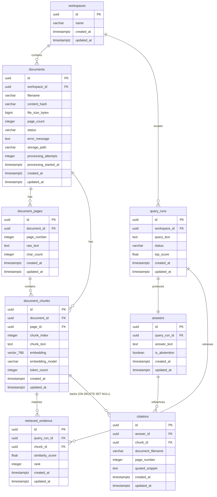
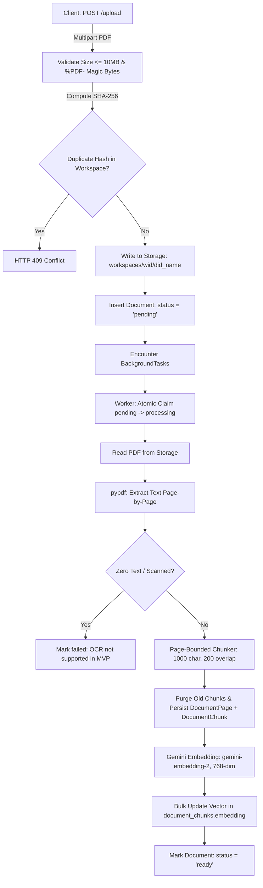

# ProofLens AI — Backend and Database Handoff for Frontend Integration

**Document Version:** 1.1.0  
**Date:** 2026-10-14  
**Author:** Backend & Platform Audit Engineering  
**Target Audience:** Next.js + TypeScript Frontend Engineers, Platform Architects  
**Governing Documents:**  
- [PRD v0.1](file:///Users/apple/Documents/Projects/ProofLense-AI/ProofLens-AI-Project-Kickoff-PRD-v0.1.md)  
- [Technical Design](file:///Users/apple/Documents/Projects/ProofLense-AI/docs/TECHNICAL-DESIGN.md)  
- [Implementation Plan](file:///Users/apple/Documents/Projects/ProofLense-AI/docs/IMPLEMENTATION-PLAN.md)  
- [Operating Guidelines (`AGENTS.md`)](file:///Users/apple/Documents/Projects/ProofLense-AI/AGENTS.md)

---

## 1. Repository and Implementation Status

### 1.1 Git Branch & Commit State
- **Current Branch:** `main`
- **Head Commit:** `90aef2a` (with backend frontend-readiness gap closures and storage driver)
- **Git Hygiene:** Zero credentials, keys, or active environment files tracked or staged.

### 1.2 Technology Stack & Dependencies
- **Runtime & Language:** Python 3.14 (compatible with Python 3.11+)
- **API Framework:** FastAPI (`0.115.8`), Starlette (`0.45.3`), Uvicorn (`0.34.0`)
- **Configuration & Validation:** Pydantic v2 (`2.10.6`), Pydantic Settings (`2.7.1`)
- **Persistence & Migrations:** SQLAlchemy 2.0 AsyncIO (`2.0.38`), `asyncpg` (`0.30.0`), Alembic (`1.14.1`), `pgvector` (`0.3.6`)
- **AI & Embeddings:** Google GenAI SDK (`google-genai` `2.0.0+`), Matryoshka Representation Learning (MRL) 768 dimensions (`gemini-embedding-2`), Structured Grounded Synthesis (`gemini-3.8-flash`)
- **Document Processing:** `pypdf` (`5.3.0`)
- **Storage Drivers:** `LocalStorageService` (local disk) & `SupabaseStorageService` (`httpx` REST client for Supabase Storage v1)
- **Testing & Verification:** `pytest` (`8.3.4`), `pytest-asyncio` (`0.25.3`), `httpx` (`0.28.1`)

### 1.3 Service Boundaries & Module Architecture

```
backend/app/
├── api/v1/                   # FastAPI route controllers
│   ├── health.py             # Unauthenticated liveness and readiness probes
│   ├── workspaces.py         # Workspace CRUD endpoints
│   ├── documents.py          # PDF streaming upload, binary retrieval, page/chunk inspection, retry, deletion
│   ├── queries.py            # Evidence-grounded Q&A execution, history listing & retrieval
│   └── comparisons.py        # Multi-document comparative analysis, history listing & retrieval
├── core/                     # Cross-cutting platform infrastructure
│   ├── config.py             # Fail-closed Pydantic BaseSettings singleton
│   ├── database.py           # AsyncPG connection pool & health checkers
│   ├── errors.py             # RFC 7807 problem details error envelopes & handlers
│   ├── lifespan.py           # Startup vector dimension checks & recovery sweeps
│   ├── logging.py            # Structured JSON logging with automatic secret redaction
│   ├── rate_limit.py         # Sliding-window in-memory request throttle middleware
│   └── security.py           # Constant-time X-Workspace-Key passkey gatekeeper
├── models/                   # SQLAlchemy 2.0 declarative database models (8 models)
│   ├── workspace.py          # Workspace scope entity
│   ├── document.py           # Document metadata & ingestion state machine
│   ├── page.py               # Physical 1-indexed document page text
│   ├── chunk.py              # Page-bounded text chunk + 768-dim vector column
│   ├── query.py              # QueryRun (with run_type 'query'|'comparison'), RetrievedEvidence, Answer
│   └── citation.py           # Snapshot Tombstone Citation entity
├── repositories/             # Database access layer
│   ├── workspace_repo.py     # Workspace queries and cascades
│   ├── document_repo.py      # Multipart persistence, worker claiming, bulk embeddings, pages/chunks
│   └── query_repo.py         # pgvector cosine search (<=>), query/comparison run persistence & listing
├── schemas/                  # Pydantic v2 API request/response contracts
│   ├── workspace.py          # Workspace schemas
│   ├── document.py           # Document, batch upload, page detail & chunk detail schemas
│   ├── query.py              # Grounded Q&A, citation, retrieved evidence & saved query schemas
│   └── comparison.py         # Comparison request, findings, saved comparison schemas
└── services/                 # Core domain services
    ├── ai/                   # Google Gemini integration
    │   ├── client.py         # Zero-leakage GenAI client factory
    │   ├── embedding.py      # Bounded batching, 768-dim finite vector validation
    │   └── generator.py      # Structured grounded synthesis & comparison prompts
    ├── comparison/           # Cross-document comparison engine
    │   └── comparator.py     # Balanced retrieval & synthesis coordinator
    ├── ingestion/            # Asynchronous ingestion worker
    │   └── worker.py         # End-to-end PDF parser -> chunker -> embedding pipeline
    ├── parsing/              # PDF extraction & text chunking
    │   ├── chunker.py        # Page-bounded sliding window chunker
    │   └── pdf_parser.py     # pypdf text extraction & scanned document detector
    ├── rag/                  # Retrieval-Augmented Generation domain logic
    │   ├── abstention.py     # Two-stage vector sufficiency evaluator
    │   ├── orchestrator.py   # RAG pipeline coordinator
    │   └── validator.py      # Server-authoritative citation & finding validator
    ├── recovery/             # Ingestion reliability
    │   └── watchdog.py       # Stale processing job recovery worker
    └── storage/              # Pluggable storage abstraction
        ├── base.py           # Abstract BaseStorageService interface
        ├── factory.py        # Storage provider factory (local vs supabase)
        ├── local.py          # Local filesystem storage with traversal defense
        └── supabase.py       # Supabase Cloud Storage REST driver via httpx

```

### 1.4 Status of Previous Gaps & Remaining Non-Blocking Debt
1. **Document Binary Streaming Endpoint (CLOSED):** `GET /api/v1/workspaces/{workspace_id}/documents/{document_id}/file` is implemented and verified. Streams `application/pdf` with `Content-Disposition: inline` and strict workspace authorization.
2. **Page Text / Chunk Inspection Endpoint (CLOSED):** `GET /api/v1/workspaces/{workspace_id}/documents/{document_id}/pages`, `GET .../documents/{document_id}/chunks/{chunk_id}`, and `GET .../chunks/{chunk_id}` are implemented and verified.
3. **Historical Query Listing (CLOSED):** `GET /api/v1/workspaces/{workspace_id}/queries` and `GET /api/v1/workspaces/{workspace_id}/queries/{query_run_id}` are implemented with pagination (`limit`, `offset`) and server-authoritative citations.
4. **Historical Comparison Listing (CLOSED):** `GET /api/v1/workspaces/{workspace_id}/comparisons` and `GET /api/v1/workspaces/{workspace_id}/comparisons/{comparison_id}` are implemented with pagination and comparative syntheses.
5. **Cloud Object Storage Provider (CLOSED TD-08):** `SupabaseStorageService` is implemented in `app/services/storage/supabase.py` using `httpx.AsyncClient` communicating directly with Supabase Storage v1 REST endpoints with upsert support, path traversal defenses, and zero secret logging.
6. **Physical Disk Cleanup on Workspace Deletion (Non-Blocking Debt TD-01):** `DELETE /api/v1/workspaces/{id}` cascades relational database rows cleanly. When using `local` storage backend, files in `./data/uploads/` require periodic maintenance cleanup. (Under `supabase` cloud storage backend, files reside in the remote bucket).

---

## 2. Complete API Inventory

The FastAPI application registers **21 endpoint operations** across **18 unique paths**. All endpoints except `/health/*` and `GET /` enforce passkey authorization.

### 2.1 Base System & Health Endpoints

#### `GET /`
- **Purpose:** Root service metadata and environment heartbeat.
- **Implementation Status:** Implemented & Verified.
- **Auth:** None (Public).
- **Request:** None.
- **Response (200 OK):**
  ```json
  {
    "name": "ProofLens AI API",
    "version": "0.1.0",
    "environment": "development",
    "status": "online"
  }
  ```
- **Source Files:** [`backend/app/main.py`](file:///Users/apple/Documents/Projects/ProofLense-AI/backend/app/main.py)
- **Tests:** [`backend/tests/integration/test_health.py`](file:///Users/apple/Documents/Projects/ProofLense-AI/backend/tests/integration/test_health.py)

#### `GET /health/live`
- **Purpose:** Infrastructure process liveness probe (used by Render / Docker).
- **Implementation Status:** Implemented & Verified.
- **Auth:** None (Public).
- **Response (200 OK):**
  ```json
  {
    "status": "alive"
  }
  ```
- **Source Files:** [`backend/app/api/v1/health.py`](file:///Users/apple/Documents/Projects/ProofLense-AI/backend/app/api/v1/health.py)
- **Tests:** [`backend/tests/integration/test_health.py`](file:///Users/apple/Documents/Projects/ProofLense-AI/backend/tests/integration/test_health.py)

#### `GET /health/ready`
- **Purpose:** Verifies PostgreSQL database connectivity and `pgvector` extension readiness.
- **Implementation Status:** Implemented & Verified.
- **Auth:** None (Public).
- **Response (200 OK):**
  ```json
  {
    "status": "ready",
    "database": "connected",
    "pgvector": true
  }
  ```
- **Error Responses:** `503 Service Unavailable` if database disconnected or `pgvector` missing.
- **Source Files:** [`backend/app/api/v1/health.py`](file:///Users/apple/Documents/Projects/ProofLense-AI/backend/app/api/v1/health.py)
- **Tests:** [`backend/tests/integration/test_health.py`](file:///Users/apple/Documents/Projects/ProofLense-AI/backend/tests/integration/test_health.py)

#### `GET /api/v1/auth-test`
- **Purpose:** Diagnostic endpoint verifying demo passkey gatekeeper functionality.
- **Implementation Status:** Implemented & Verified.
- **Auth:** Required (`X-Workspace-Key`).
- **Response (200 OK):**
  ```json
  {
    "authenticated": true,
    "message": "Passkey verified successfully."
  }
  ```
- **Error Responses:** `401 Unauthorized` if header missing or mismatch.
- **Source Files:** [`backend/app/main.py`](file:///Users/apple/Documents/Projects/ProofLense-AI/backend/app/main.py)
- **Tests:** [`backend/tests/unit/test_security.py`](file:///Users/apple/Documents/Projects/ProofLense-AI/backend/tests/unit/test_security.py)

---

### 2.2 Workspace Endpoints

#### `POST /api/v1/workspaces`
- **Purpose:** Create an isolated workspace for document uploads and queries.
- **Implementation Status:** Implemented & Verified.
- **Auth:** Required (`X-Workspace-Key`).
- **Request Body (`WorkspaceCreate`):**
  ```json
  {
    "name": "Acme Corp Due Diligence"
  }
  ```
  *Validation:* `name` (string, 1 to 255 characters).
- **Response (201 Created — `WorkspaceResponse`):**
  ```json
  {
    "id": "7b049d52-5a5c-4d37-8326-0e31e5f8f537",
    "name": "Acme Corp Due Diligence",
    "created_at": "2026-10-14T02:30:00.000000Z",
    "updated_at": "2026-10-14T02:30:00.000000Z"
  }
  ```
- **Error Responses:** `401 Unauthorized`, `422 Unprocessable Entity`.
- **Source Files:** [`backend/app/api/v1/workspaces.py`](file:///Users/apple/Documents/Projects/ProofLense-AI/backend/app/api/v1/workspaces.py)
- **Tests:** [`backend/tests/integration/test_workspaces_documents.py`](file:///Users/apple/Documents/Projects/ProofLense-AI/backend/tests/integration/test_workspaces_documents.py)

#### `GET /api/v1/workspaces`
- **Purpose:** Retrieve all workspaces.
- **Implementation Status:** Implemented & Verified.
- **Auth:** Required (`X-Workspace-Key`).
- **Response (200 OK — `List[WorkspaceResponse]`):**
  ```json
  [
    {
      "id": "7b049d52-5a5c-4d37-8326-0e31e5f8f537",
      "name": "Acme Corp Due Diligence",
      "created_at": "2026-10-14T02:30:00.000000Z",
      "updated_at": "2026-10-14T02:30:00.000000Z"
    }
  ]
  ```
- **Source Files:** [`backend/app/api/v1/workspaces.py`](file:///Users/apple/Documents/Projects/ProofLense-AI/backend/app/api/v1/workspaces.py)
- **Tests:** [`backend/tests/integration/test_workspaces_documents.py`](file:///Users/apple/Documents/Projects/ProofLense-AI/backend/tests/integration/test_workspaces_documents.py)

#### `GET /api/v1/workspaces/{workspace_id}`
- **Purpose:** Retrieve single workspace details.
- **Implementation Status:** Implemented & Verified.
- **Auth:** Required (`X-Workspace-Key`).
- **Path Parameters:** `workspace_id` (UUID).
- **Response (200 OK — `WorkspaceResponse`):**
  ```json
  {
    "id": "7b049d52-5a5c-4d37-8326-0e31e5f8f537",
    "name": "Acme Corp Due Diligence",
    "created_at": "2026-10-14T02:30:00.000000Z",
    "updated_at": "2026-10-14T02:30:00.000000Z"
  }
  ```
- **Error Responses:** `404 Not Found` (`RESOURCE_NOT_FOUND`).
- **Source Files:** [`backend/app/api/v1/workspaces.py`](file:///Users/apple/Documents/Projects/ProofLense-AI/backend/app/api/v1/workspaces.py)
- **Tests:** [`backend/tests/integration/test_workspaces_documents.py`](file:///Users/apple/Documents/Projects/ProofLense-AI/backend/tests/integration/test_workspaces_documents.py)

#### `DELETE /api/v1/workspaces/{workspace_id}`
- **Purpose:** Delete workspace and cascade-delete all contained documents, pages, chunks, queries, and citations.
- **Implementation Status:** Implemented & Verified.
- **Auth:** Required (`X-Workspace-Key`).
- **Path Parameters:** `workspace_id` (UUID).
- **Response:** `204 No Content`.
- **Error Responses:** `404 Not Found` (`RESOURCE_NOT_FOUND`).
- **Source Files:** [`backend/app/api/v1/workspaces.py`](file:///Users/apple/Documents/Projects/ProofLense-AI/backend/app/api/v1/workspaces.py)
- **Tests:** [`backend/tests/integration/test_workspaces_documents.py`](file:///Users/apple/Documents/Projects/ProofLense-AI/backend/tests/integration/test_workspaces_documents.py)

---

### 2.3 Document Ingestion Endpoints

#### `POST /api/v1/workspaces/{workspace_id}/documents/upload`
- **Purpose:** Secure streaming upload of 1 to 5 PDF files, creating database records in `pending` status and scheduling asynchronous background ingestion.
- **Implementation Status:** Implemented & Verified.
- **Auth:** Required (`X-Workspace-Key`).
- **Path Parameters:** `workspace_id` (UUID).
- **Request Content-Type:** `multipart/form-data`
- **Request Body:** `files`: List of multipart binary files.
- **Guardrails:**
  - Max batch size: $\le 5$ files (trips `400 Bad Request` `BATCH_LIMIT_EXCEEDED`).
  - Max single file size: 10,485,760 bytes (10 MB, trips `413 Content Too Large` `FILE_TOO_LARGE`).
  - Magic byte validation: Must start with `%PDF-` (trips `400 Bad Request` `INVALID_PDF_SIGNATURE`).
  - Duplicate SHA-256 detection: Rejects duplicates within same workspace (trips `409 Conflict` `DUPLICATE_DOCUMENT`).
- **Response (201 Created — `UploadBatchResponse`):**
  ```json
  {
    "uploaded": [
      {
        "id": "e9326e03-750d-40d9-b364-777e923e42ea",
        "workspace_id": "7b049d52-5a5c-4d37-8326-0e31e5f8f537",
        "filename": "Q3_Report.pdf",
        "content_hash": "e3b0c44298fc1c149afbf4c8996fb92427ae41e4649b934ca495991b7852b855",
        "file_size_bytes": 1048576,
        "page_count": null,
        "status": "pending",
        "error_message": null,
        "processing_attempts": 0,
        "processing_started_at": null,
        "created_at": "2026-10-14T02:35:00.000000Z",
        "updated_at": "2026-10-14T02:35:00.000000Z"
      }
    ],
    "total_uploaded": 1
  }
  ```
- **Error Responses:** `400 Bad Request`, `404 Not Found`, `409 Conflict`, `413 Content Too Large`, `429 Too Many Requests` (upload limit 30/hour).
- **Source Files:** [`backend/app/api/v1/documents.py`](file:///Users/apple/Documents/Projects/ProofLense-AI/backend/app/api/v1/documents.py)
- **Tests:** [`backend/tests/integration/test_workspaces_documents.py`](file:///Users/apple/Documents/Projects/ProofLense-AI/backend/tests/integration/test_workspaces_documents.py)

#### `GET /api/v1/workspaces/{workspace_id}/documents`
- **Purpose:** List all documents in a workspace to monitor ingestion statuses (`pending`, `processing`, `ready`, `failed`).
- **Implementation Status:** Implemented & Verified.
- **Auth:** Required (`X-Workspace-Key`).
- **Path Parameters:** `workspace_id` (UUID).
- **Response (200 OK — `List[DocumentResponse]`):**
  ```json
  [
    {
      "id": "e9326e03-750d-40d9-b364-777e923e42ea",
      "workspace_id": "7b049d52-5a5c-4d37-8326-0e31e5f8f537",
      "filename": "Q3_Report.pdf",
      "content_hash": "e3b0c44298fc1c149afbf4c8996fb92427ae41e4649b934ca495991b7852b855",
      "file_size_bytes": 1048576,
      "page_count": 12,
      "status": "ready",
      "error_message": null,
      "processing_attempts": 1,
      "processing_started_at": "2026-10-14T02:35:01.000000Z",
      "created_at": "2026-10-14T02:35:00.000000Z",
      "updated_at": "2026-10-14T02:35:05.000000Z"
    }
  ]
  ```
- **Source Files:** [`backend/app/api/v1/documents.py`](file:///Users/apple/Documents/Projects/ProofLense-AI/backend/app/api/v1/documents.py)
- **Tests:** [`backend/tests/integration/test_workspaces_documents.py`](file:///Users/apple/Documents/Projects/ProofLense-AI/backend/tests/integration/test_workspaces_documents.py)

#### `GET /api/v1/workspaces/{workspace_id}/documents/{document_id}`
- **Purpose:** Retrieve single document metadata and processing status.
- **Implementation Status:** Implemented & Verified.
- **Auth:** Required (`X-Workspace-Key`).
- **Path Parameters:** `workspace_id` (UUID), `document_id` (UUID).
- **Response (200 OK — `DocumentResponse`):** Same schema as above.
- **Error Responses:** `404 Not Found` (`RESOURCE_NOT_FOUND`).
- **Source Files:** [`backend/app/api/v1/documents.py`](file:///Users/apple/Documents/Projects/ProofLense-AI/backend/app/api/v1/documents.py)
- **Tests:** [`backend/tests/integration/test_workspaces_documents.py`](file:///Users/apple/Documents/Projects/ProofLense-AI/backend/tests/integration/test_workspaces_documents.py)

#### `DELETE /api/v1/workspaces/{workspace_id}/documents/{document_id}`
- **Purpose:** Safe two-step document deletion: row-level lock (`SELECT ... FOR UPDATE`), transactional cascade in PostgreSQL, and physical file purge from storage.
- **Implementation Status:** Implemented & Verified.
- **Auth:** Required (`X-Workspace-Key`).
- **Path Parameters:** `workspace_id` (UUID), `document_id` (UUID).
- **Response:** `204 No Content`.
- **Error Responses:** `404 Not Found` (`RESOURCE_NOT_FOUND`).
- **Source Files:** [`backend/app/api/v1/documents.py`](file:///Users/apple/Documents/Projects/ProofLense-AI/backend/app/api/v1/documents.py)
- **Tests:** [`backend/tests/integration/test_workspaces_documents.py`](file:///Users/apple/Documents/Projects/ProofLense-AI/backend/tests/integration/test_workspaces_documents.py)

#### `POST /api/v1/workspaces/{workspace_id}/documents/{document_id}/retry`
- **Purpose:** Manually re-trigger ingestion for a document in `failed` status via atomic worker claiming.
- **Implementation Status:** Implemented & Verified.
- **Auth:** Required (`X-Workspace-Key`).
- **Path Parameters:** `workspace_id` (UUID), `document_id` (UUID).
- **Response (200 OK — `DocumentResponse`):** Updated document record with `status: "processing"`.
- **Error Responses:**
  - `400 Bad Request` (`DOCUMENT_NOT_FAILED` if document is not in `failed` state).
  - `404 Not Found` (`RESOURCE_NOT_FOUND`).
  - `409 Conflict` (`CONCURRENT_JOB_CLAIM` if claimed by another worker).
- **Source Files:** [`backend/app/api/v1/documents.py`](file:///Users/apple/Documents/Projects/ProofLense-AI/backend/app/api/v1/documents.py)
- **Tests:** [`backend/tests/integration/test_document_ingestion_pipeline.py`](file:///Users/apple/Documents/Projects/ProofLense-AI/backend/tests/integration/test_document_ingestion_pipeline.py)

#### `GET /api/v1/workspaces/{workspace_id}/documents/{document_id}/file`
- **Purpose:** Retrieve the raw uploaded PDF binary for rendering in the Next.js PDF canvas/viewer.
- **Implementation Status:** Implemented & Verified.
- **Auth:** Required (`X-Workspace-Key`).
- **Path Parameters:** `workspace_id` (UUID), `document_id` (UUID).
- **Response (200 OK):** Binary stream with:
  - `Content-Type: application/pdf`
  - `Content-Disposition: inline; filename="{filename}"`
  - `Content-Length: {file_size_bytes}`
- **Error Responses:**
  - `401 Unauthorized` (missing/invalid passkey).
  - `404 Not Found` (`RESOURCE_NOT_FOUND` if document does not belong to workspace, or `FILE_NOT_FOUND` if storage blob missing).
- **Source Files:** [`backend/app/api/v1/documents.py`](file:///Users/apple/Documents/Projects/ProofLense-AI/backend/app/api/v1/documents.py)
- **Tests:** [`backend/tests/integration/test_document_endpoints_closure.py`](file:///Users/apple/Documents/Projects/ProofLense-AI/backend/tests/integration/test_document_endpoints_closure.py)

#### `GET /api/v1/workspaces/{workspace_id}/documents/{document_id}/pages`
- **Purpose:** Retrieve extracted page text and embedded chunk evidence metadata for a document.
- **Implementation Status:** Implemented & Verified.
- **Auth:** Required (`X-Workspace-Key`).
- **Path Parameters:** `workspace_id` (UUID), `document_id` (UUID).
- **Query Parameters:** `page_number` (optional integer $\ge 1$ to filter to a single page).
- **Response (200 OK — `DocumentPagesResponse`):**
  ```json
  {
    "document_id": "e9326e03-750d-40d9-b364-777e923e42ea",
    "workspace_id": "7b049d52-5a5c-4d37-8326-0e31e5f8f537",
    "total_pages": 12,
    "pages": [
      {
        "id": "335637ed-09f3-4b84-9b5e-e6070f82ea69",
        "document_id": "e9326e03-750d-40d9-b364-777e923e42ea",
        "page_number": 1,
        "raw_text": "Executive summary of financial performance...",
        "char_count": 1420,
        "chunks": [
          {
            "id": "b18f0c29-43c2-48de-8d1e-2e2ff629e4b7",
            "document_id": "e9326e03-750d-40d9-b364-777e923e42ea",
            "page_id": "335637ed-09f3-4b84-9b5e-e6070f82ea69",
            "chunk_index": 0,
            "chunk_text": "Executive summary of financial performance...",
            "token_count": 250,
            "page_number": 1
          }
        ]
      }
    ]
  }
  ```
- **Error Responses:** `401 Unauthorized`, `404 Not Found` (`RESOURCE_NOT_FOUND`).
- **Source Files:** [`backend/app/api/v1/documents.py`](file:///Users/apple/Documents/Projects/ProofLense-AI/backend/app/api/v1/documents.py)
- **Tests:** [`backend/tests/integration/test_document_endpoints_closure.py`](file:///Users/apple/Documents/Projects/ProofLense-AI/backend/tests/integration/test_document_endpoints_closure.py)

#### `GET /api/v1/workspaces/{workspace_id}/documents/{document_id}/chunks/{chunk_id}`
- **Purpose:** Retrieve exact chunk content and physical page provenance scoped to document and workspace.
- **Implementation Status:** Implemented & Verified.
- **Auth:** Required (`X-Workspace-Key`).
- **Path Parameters:** `workspace_id` (UUID), `document_id` (UUID), `chunk_id` (UUID).
- **Response (200 OK — `DocumentChunkDetailResponse`):**
  ```json
  {
    "id": "b18f0c29-43c2-48de-8d1e-2e2ff629e4b7",
    "document_id": "e9326e03-750d-40d9-b364-777e923e42ea",
    "page_id": "335637ed-09f3-4b84-9b5e-e6070f82ea69",
    "chunk_index": 0,
    "chunk_text": "Executive summary of financial performance...",
    "token_count": 250,
    "page_number": 1
  }
  ```
- **Error Responses:** `401 Unauthorized`, `404 Not Found` (`RESOURCE_NOT_FOUND`).
- **Source Files:** [`backend/app/api/v1/documents.py`](file:///Users/apple/Documents/Projects/ProofLense-AI/backend/app/api/v1/documents.py)
- **Tests:** [`backend/tests/integration/test_document_endpoints_closure.py`](file:///Users/apple/Documents/Projects/ProofLense-AI/backend/tests/integration/test_document_endpoints_closure.py)

#### `GET /api/v1/workspaces/{workspace_id}/chunks/{chunk_id}`
- **Purpose:** Direct chunk retrieval across a workspace for citation click handling (when only `chunk_id` is available).
- **Implementation Status:** Implemented & Verified.
- **Auth:** Required (`X-Workspace-Key`).
- **Path Parameters:** `workspace_id` (UUID), `chunk_id` (UUID).
- **Response (200 OK — `DocumentChunkDetailResponse`):** Same schema as above.
- **Error Responses:** `401 Unauthorized`, `404 Not Found` (`RESOURCE_NOT_FOUND`).
- **Source Files:** [`backend/app/api/v1/documents.py`](file:///Users/apple/Documents/Projects/ProofLense-AI/backend/app/api/v1/documents.py)
- **Tests:** [`backend/tests/integration/test_document_endpoints_closure.py`](file:///Users/apple/Documents/Projects/ProofLense-AI/backend/tests/integration/test_document_endpoints_closure.py)

---

### 2.4 Grounded Q&A Endpoint

#### `POST /api/v1/workspaces/{workspace_id}/queries`
- **Purpose:** Execute natural-language evidence-grounded question answering with server-authoritative page-level citations.
- **Implementation Status:** Implemented & Verified.
- **Auth:** Required (`X-Workspace-Key`).
- **Path Parameters:** `workspace_id` (UUID).
- **Request Body (`QueryRequest`):**
  ```json
  {
    "query_text": "What was the total operating income reported for 2024?",
    "top_k": 5
  }
  ```
  *Validation:* `query_text` (string, 1 to 2000 chars), `top_k` (optional int, 1 to 20, default: 5).
- **Response (200 OK — `QueryResponse`):**
  ```json
  {
    "query_run_id": "9a1bf042-3e28-4b71-bdfc-8cbfa194726a",
    "workspace_id": "7b049d52-5a5c-4d37-8326-0e31e5f8f537",
    "query_text": "What was the total operating income reported for 2024?",
    "status": "completed",
    "answer_text": "In 2024, total operating income reached $14.2 million, representing an 18% increase year-over-year.",
    "is_abstention": false,
    "top_score": 0.8421,
    "citations": [
      {
        "id": "f51270bc-5913-431f-9da3-9b8bf1e7795a",
        "chunk_id": "b18f0c29-43c2-48de-8d1e-2e2ff629e4b7",
        "document_id": "e9326e03-750d-40d9-b364-777e923e42ea",
        "document_filename": "Q3_Report.pdf",
        "page_number": 4,
        "quoted_snippet": "Operating income for fiscal year 2024 was reported at $14.2 million, compared to $12.0 million in 2023."
      }
    ],
    "retrieved_evidence": [
      {
        "chunk_id": "b18f0c29-43c2-48de-8d1e-2e2ff629e4b7",
        "document_id": "e9326e03-750d-40d9-b364-777e923e42ea",
        "document_filename": "Q3_Report.pdf",
        "page_number": 4,
        "snippet": "Operating income for fiscal year 2024 was reported at $14.2 million, compared to $12.0 million in 2023.",
        "similarity_score": 0.8421,
        "rank": 1
      }
    ],
    "created_at": "2026-10-14T02:40:00.000000Z"
  }
  ```
- **Abstention Response Example (When `top_score < 0.65` or insufficient evidence):**
  ```json
  {
    "query_run_id": "1198f391-72ef-4965-a83d-d1be8b7762ac",
    "workspace_id": "7b049d52-5a5c-4d37-8326-0e31e5f8f537",
    "query_text": "What is the CEO's personal home address?",
    "status": "completed",
    "answer_text": "I do not have sufficient document evidence in this workspace to answer your question.",
    "is_abstention": true,
    "top_score": null,
    "citations": [],
    "retrieved_evidence": [],
    "created_at": "2026-10-14T02:41:00.000000Z"
  }
  ```
- **Error Responses:** `401 Unauthorized`, `404 Not Found`, `422 Unprocessable Entity`, `429 Too Many Requests` (20/min), `502 Bad Gateway` (`AI_PROVIDER_ERROR`).
- **Source Files:** [`backend/app/api/v1/queries.py`](file:///Users/apple/Documents/Projects/ProofLense-AI/backend/app/api/v1/queries.py), [`backend/app/services/rag/orchestrator.py`](file:///Users/apple/Documents/Projects/ProofLense-AI/backend/app/services/rag/orchestrator.py)
- **Tests:** [`backend/tests/integration/test_rag_pipeline.py`](file:///Users/apple/Documents/Projects/ProofLense-AI/backend/tests/integration/test_rag_pipeline.py), [`backend/tests/unit/test_citation_validator.py`](file:///Users/apple/Documents/Projects/ProofLense-AI/backend/tests/unit/test_citation_validator.py)

#### `GET /api/v1/workspaces/{workspace_id}/queries`
- **Purpose:** List historical grounded Q&A query runs and answers for a workspace with pagination.
- **Implementation Status:** Implemented & Verified.
- **Auth:** Required (`X-Workspace-Key`).
- **Path Parameters:** `workspace_id` (UUID).
- **Query Parameters:**
  - `limit`: integer, $1 \le \text{limit} \le 100$, default 50.
  - `offset`: integer $\ge 0$, default 0.
- **Response (200 OK — `List[QueryResponse]`):** Ordered by newest execution first. Each item contains `query_run_id`, `query_text`, `status`, `answer_text`, `is_abstention`, `top_score`, `citations`, and `retrieved_evidence`.
- **Error Responses:** `401 Unauthorized`, `404 Not Found` (`RESOURCE_NOT_FOUND`).
- **Source Files:** [`backend/app/api/v1/queries.py`](file:///Users/apple/Documents/Projects/ProofLense-AI/backend/app/api/v1/queries.py)
- **Tests:** [`backend/tests/integration/test_query_endpoints_closure.py`](file:///Users/apple/Documents/Projects/ProofLense-AI/backend/tests/integration/test_query_endpoints_closure.py)

#### `GET /api/v1/workspaces/{workspace_id}/queries/{query_run_id}`
- **Purpose:** Retrieve a specific grounded Q&A execution with its answer, verified citations, and candidate evidence.
- **Implementation Status:** Implemented & Verified.
- **Auth:** Required (`X-Workspace-Key`).
- **Path Parameters:** `workspace_id` (UUID), `query_run_id` (UUID).
- **Response (200 OK — `QueryResponse`):** Same schema as `POST /queries`.
- **Error Responses:** `401 Unauthorized`, `404 Not Found` (`RESOURCE_NOT_FOUND`).
- **Source Files:** [`backend/app/api/v1/queries.py`](file:///Users/apple/Documents/Projects/ProofLense-AI/backend/app/api/v1/queries.py)
- **Tests:** [`backend/tests/integration/test_query_endpoints_closure.py`](file:///Users/apple/Documents/Projects/ProofLense-AI/backend/tests/integration/test_query_endpoints_closure.py)

---

### 2.5 Cross-Document Comparison Endpoint

#### `POST /api/v1/workspaces/{workspace_id}/comparisons`
- **Purpose:** Execute multi-document comparative analysis across 2 to 5 documents with balanced vector retrieval, finding classifications (`agreement`, `contradiction`, `difference`, `not_found`), and verified citations.
- **Implementation Status:** Implemented & Verified.
- **Auth:** Required (`X-Workspace-Key`).
- **Path Parameters:** `workspace_id` (UUID).
- **Request Body (`ComparisonRequest`):**
  ```json
  {
    "query_text": "Compare the reported revenue and margin guidance for 2024 and 2025.",
    "document_ids": [
      "e9326e03-750d-40d9-b364-777e923e42ea",
      "fa821b04-129a-4c28-98e3-4fbb1190bc12"
    ]
  }
  ```
  *Validation:* `query_text` (string, 3 to 1000 chars), `document_ids` (optional list of 2 to 5 UUIDs; if omitted, automatically selects ready documents in workspace up to 5).
- **Response (200 OK — `ComparisonResponse`):**
  ```json
  {
    "comparison_id": "3a011de8-bc72-4d10-822e-131ef9130722",
    "workspace_id": "7b049d52-5a5c-4d37-8326-0e31e5f8f537",
    "query_text": "Compare the reported revenue and margin guidance for 2024 and 2025.",
    "document_ids": [
      "e9326e03-750d-40d9-b364-777e923e42ea",
      "fa821b04-129a-4c28-98e3-4fbb1190bc12"
    ],
    "status": "completed",
    "is_abstention": false,
    "findings": [
      {
        "finding_type": "contradiction",
        "topic": "Operating Margin Target",
        "summary": "Document A forecasts operating margins of 18.5%, whereas Document B projects margins dropping to 14.0%.",
        "per_document_evidence": [
          {
            "document_id": "e9326e03-750d-40d9-b364-777e923e42ea",
            "document_filename": "Q3_Report.pdf",
            "statement": "Projects operating margin of 18.5% for next fiscal year.",
            "citations": [
              {
                "id": "0194812a-8921-4f1b-a01b-c124898129ab",
                "chunk_id": "b18f0c29-43c2-48de-8d1e-2e2ff629e4b7",
                "document_id": "e9326e03-750d-40d9-b364-777e923e42ea",
                "document_filename": "Q3_Report.pdf",
                "page_number": 6,
                "quoted_snippet": "We expect full-year operating margins to expand to 18.5%."
              }
            ]
          },
          {
            "document_id": "fa821b04-129a-4c28-98e3-4fbb1190bc12",
            "document_filename": "2025_Strategy_Plan.pdf",
            "statement": "Projects margins contracting to 14.0% due to expansion investments.",
            "citations": [
              {
                "id": "18924bcf-a192-4112-98ab-81923847192a",
                "chunk_id": "cd912830-4819-4820-9182-481294819230",
                "document_id": "fa821b04-129a-4c28-98e3-4fbb1190bc12",
                "document_filename": "2025_Strategy_Plan.pdf",
                "page_number": 2,
                "quoted_snippet": "Conservative modeling indicates near-term operating margins of approximately 14.0%."
              }
            ]
          }
        ],
        "citations": [
          {
            "id": "0194812a-8921-4f1b-a01b-c124898129ab",
            "chunk_id": "b18f0c29-43c2-48de-8d1e-2e2ff629e4b7",
            "document_id": "e9326e03-750d-40d9-b364-777e923e42ea",
            "document_filename": "Q3_Report.pdf",
            "page_number": 6,
            "quoted_snippet": "We expect full-year operating margins to expand to 18.5%."
          },
          {
            "id": "18924bcf-a192-4112-98ab-81923847192a",
            "chunk_id": "cd912830-4819-4820-9182-481294819230",
            "document_id": "fa821b04-129a-4c28-98e3-4fbb1190bc12",
            "document_filename": "2025_Strategy_Plan.pdf",
            "page_number": 2,
            "quoted_snippet": "Conservative modeling indicates near-term operating margins of approximately 14.0%."
          }
        ]
      }
    ],
    "synthesis": "The compared documents show fundamental divergence regarding margin trajectories while agreeing on overall revenue trends.",
    "limitations": "The 2025 Strategy Plan assumes capital expenditure increases not factored into the earlier Q3 Report.",
    "retrieved_evidence": [
      {
        "chunk_id": "b18f0c29-43c2-48de-8d1e-2e2ff629e4b7",
        "document_id": "e9326e03-750d-40d9-b364-777e923e42ea",
        "document_filename": "Q3_Report.pdf",
        "page_number": 6,
        "snippet": "We expect full-year operating margins to expand to 18.5%.",
        "similarity_score": 0.812,
        "rank": 1
      }
    ],
    "created_at": "2026-10-14T02:45:00.000000Z"
  }
  ```
- **Error Responses:**
  - `400 Bad Request` (`INVALID_COMPARISON_REQUEST` if $<2$ or $>5$ documents selected, or if fewer than 2 ready documents exist in the workspace, or if selected document is not ready).
  - `401 Unauthorized`.
  - `404 Not Found` (`RESOURCE_NOT_FOUND` if workspace or any specified document UUID does not exist).
  - `422 Unprocessable Entity`.
  - `502 Bad Gateway` (`AI_PROVIDER_ERROR`).
- **Source Files:** [`backend/app/api/v1/comparisons.py`](file:///Users/apple/Documents/Projects/ProofLense-AI/backend/app/api/v1/comparisons.py), [`backend/app/services/comparison/comparator.py`](file:///Users/apple/Documents/Projects/ProofLense-AI/backend/app/services/comparison/comparator.py)
- **Tests:** [`backend/tests/integration/test_comparisons.py`](file:///Users/apple/Documents/Projects/ProofLense-AI/backend/tests/integration/test_comparisons.py), [`backend/tests/unit/test_comparison_validator.py`](file:///Users/apple/Documents/Projects/ProofLense-AI/backend/tests/unit/test_comparison_validator.py)

#### `GET /api/v1/workspaces/{workspace_id}/comparisons`
- **Purpose:** List historical cross-document comparison runs and syntheses for a workspace with pagination.
- **Implementation Status:** Implemented & Verified.
- **Auth:** Required (`X-Workspace-Key`).
- **Path Parameters:** `workspace_id` (UUID).
- **Query Parameters:**
  - `limit`: integer, $1 \le \text{limit} \le 100$, default 50.
  - `offset`: integer $\ge 0$, default 0.
- **Response (200 OK — `List[SavedComparisonResponse]`):** Ordered by newest execution first.
  ```json
  [
    {
      "comparison_id": "3a011de8-bc72-4d10-822e-131ef9130722",
      "workspace_id": "7b049d52-5a5c-4d37-8326-0e31e5f8f537",
      "query_text": "Compare Q3 vs Q4 guidance.",
      "status": "completed",
      "is_abstention": false,
      "top_score": 0.95,
      "synthesis": "Comparative synthesis: revenue expanded by 20%.",
      "citations": [
        {
          "id": "e481b0f1-419b-4b10-8912-88ef19230192",
          "chunk_id": "b18f0c29-43c2-48de-8d1e-2e2ff629e4b7",
          "document_id": "e9326e03-750d-40d9-b364-777e923e42ea",
          "document_filename": "Q3_Report.pdf",
          "page_number": 6,
          "quoted_snippet": "We expect full-year operating margins to expand to 18.5%."
        }
      ],
      "retrieved_evidence": [],
      "created_at": "2026-10-14T02:45:00.000000Z"
    }
  ]
  ```
- **Error Responses:** `401 Unauthorized`, `404 Not Found` (`RESOURCE_NOT_FOUND`).
- **Source Files:** [`backend/app/api/v1/comparisons.py`](file:///Users/apple/Documents/Projects/ProofLense-AI/backend/app/api/v1/comparisons.py)
- **Tests:** [`backend/tests/integration/test_comparison_endpoints_closure.py`](file:///Users/apple/Documents/Projects/ProofLense-AI/backend/tests/integration/test_comparison_endpoints_closure.py)

#### `GET /api/v1/workspaces/{workspace_id}/comparisons/{comparison_id}`
- **Purpose:** Retrieve a specific saved cross-document comparison execution with its narrative synthesis, verified citations, and candidate evidence.
- **Implementation Status:** Implemented & Verified.
- **Auth:** Required (`X-Workspace-Key`).
- **Path Parameters:** `workspace_id` (UUID), `comparison_id` (UUID).
- **Response (200 OK — `SavedComparisonResponse`):** Same schema as above.
- **Error Responses:** `401 Unauthorized`, `404 Not Found` (`RESOURCE_NOT_FOUND`).
- **Source Files:** [`backend/app/api/v1/comparisons.py`](file:///Users/apple/Documents/Projects/ProofLense-AI/backend/app/api/v1/comparisons.py)
- **Tests:** [`backend/tests/integration/test_comparison_endpoints_closure.py`](file:///Users/apple/Documents/Projects/ProofLense-AI/backend/tests/integration/test_comparison_endpoints_closure.py)

---

## 3. Authentication and Security

### 3.1 Authentication Mechanism
ProofLens AI uses an **Application-Level Access Passkey Gatekeeper**:
- **Header:** `X-Workspace-Key`
- **Validation:** Server performs a constant-time cryptographic comparison using Python's `secrets.compare_digest` against the configured `DEMO_ACCESS_TOKEN`.
- **Timing Defense:** Constant-time comparison ensures zero timing-leak vulnerabilities.
- **Fail-Closed Startup:** In production (`ENVIRONMENT="production"`), the application strictly refuses to start up if `DEMO_ACCESS_TOKEN` is missing, empty, or shorter than 16 characters.

### 3.2 Session & Request Lifecycle for Frontend
- **Stateless Request Flow:** The backend does **not** issue session cookies, refresh tokens, or OAuth tokens.
- **Client Obligation:** The Next.js frontend must capture the user's access passkey (e.g., via a prompt modal or workspace settings drawer), store it securely on the client (or in a Next.js server cookie/session), and inject it into the `X-Workspace-Key` header on every API request.
- **Header Name:** `X-Workspace-Key` (exact casing).

### 3.3 Authorization & Scoping
- **Workspace Isolation:** Every resource URL is scoped by `/api/v1/workspaces/{workspace_id}/...`.
- **Database Boundary:** All SQL queries strictly filter by `workspace_id`. Cross-workspace document retrieval, vector scans, or mutations are prevented at the repository layer.
- **Fail-Safe Missing Passkey:** When authentication is enabled and the header is missing, the backend returns `401 Unauthorized` with `WWW-Authenticate: Passkey`.

### 3.4 CORS Configuration
- **Settings Variable:** `CORS_ALLOWED_ORIGINS` (comma-separated origins, default `http://localhost:3000`).
- **Configuration:**
  - `allow_credentials=True`
  - `allow_methods=["GET", "POST", "PUT", "PATCH", "DELETE", "OPTIONS"]`
  - `allow_headers=["*"]` (permits `X-Workspace-Key`, `Content-Type`, `Accept`)
- **Frontend Requirement:** For local development, Next.js runs on `http://localhost:3000`. For production Vercel deployments, the frontend domain (e.g., `https://prooflens.vercel.app`) must be added to the backend `CORS_ALLOWED_ORIGINS` environment variable on Render.

### 3.5 Standardized RFC 7807 Error Envelope
All error responses from the backend conform strictly to the uniform JSON format:

```json
{
  "error_code": "RESOURCE_NOT_FOUND",
  "message": "Document 'e9326e03-750d-40d9-b364-777e923e42ea' not found in workspace '7b049d52-5a5c-4d37-8326-0e31e5f8f537'.",
  "details": {
    "workspace_id": "7b049d52-5a5c-4d37-8326-0e31e5f8f537",
    "document_id": "e9326e03-750d-40d9-b364-777e923e42ea"
  },
  "timestamp": "2026-10-14T02:46:12.198210Z"
}
```

#### Error Code Catalog:
| Error Code | HTTP Status | Description / Condition |
| :--- | :---: | :--- |
| `UNAUTHORIZED` | 401 | Missing or invalid `X-Workspace-Key` header. |
| `FORBIDDEN` | 403 | Access denied to workspace resource. |
| `RESOURCE_NOT_FOUND` | 404 | Workspace, Document, or Query ID does not exist. |
| `BATCH_LIMIT_EXCEEDED` | 400 | Upload contains $> 5$ files. |
| `INVALID_PDF_SIGNATURE`| 400 | Uploaded file does not begin with `%PDF-`. |
| `DOCUMENT_NOT_FAILED` | 400 | Retry attempted on document not in `failed` state. |
| `INVALID_COMPARISON_REQUEST` | 400 | Fewer than 2 ready documents or $> 5$ documents selected. |
| `DUPLICATE_DOCUMENT` | 409 | Document with identical SHA-256 already exists in workspace. |
| `CONCURRENT_JOB_CLAIM` | 409 | Document already claimed by another ingestion worker. |
| `FILE_TOO_LARGE` | 413 | Uploaded file exceeds 10 MB (10,485,760 bytes). |
| `VALIDATION_ERROR` | 422 | Pydantic validation failure (payload field types/lengths). |
| `RATE_LIMIT_EXCEEDED` | 429 | Sliding-window limit reached. Includes `Retry-After` header. |
| `AI_PROVIDER_ERROR` | 502 | Upstream Gemini API timeout or rate limit failure. |
| `INTERNAL_SERVER_ERROR`| 500 | Unhandled server error (traceback suppressed). |

### 3.6 Rate Limiting
The backend enforces sliding-window in-memory throttling per client IP:
- **Queries:** 20 requests / minute (`/queries`)
- **Uploads:** 30 requests / hour (`/upload`)
- **General APIs:** 120 requests / minute
- **Response:** `HTTP 429 Too Many Requests` with `Retry-After: <seconds>` header.

---

## 4. Database Schema and Migrations

### 4.1 PostgreSQL Schema Architecture

The database schema consists of **8 relational tables** managed via Alembic revision `0001_initial_schema`.



### 4.2 Detailed Table Specifications

#### 1. `workspaces`
- `id` (UUID, Primary Key)
- `name` (VARCHAR(255), NOT NULL)
- `created_at`, `updated_at` (TIMESTAMPTZ, NOT NULL)
- *Indexes:* `ix_workspaces_id`

#### 2. `documents`
- `id` (UUID, Primary Key)
- `workspace_id` (UUID, FK `workspaces.id` `ON DELETE CASCADE`, NOT NULL)
- `filename` (VARCHAR(255), NOT NULL)
- `content_hash` (VARCHAR(64), SHA-256 hex, NOT NULL)
- `file_size_bytes` (BIGINT, NOT NULL)
- `page_count` (INTEGER, NULLABLE)
- `status` (VARCHAR(50), NOT NULL, default `'pending'`) — States: `'pending'`, `'processing'`, `'ready'`, `'failed'`
- `error_message` (TEXT, NULLABLE)
- `storage_path` (VARCHAR(1024), NOT NULL)
- `processing_attempts` (INTEGER, NOT NULL, default `0`)
- `processing_started_at` (TIMESTAMPTZ, NULLABLE)
- `created_at`, `updated_at` (TIMESTAMPTZ, NOT NULL)
- *Constraints:* `uq_workspace_content_hash` UNIQUE(`workspace_id`, `content_hash`)
- *Indexes:* `ix_documents_id`, `ix_documents_workspace_id`, `ix_documents_content_hash`, `ix_documents_status`

#### 3. `document_pages`
- `id` (UUID, Primary Key)
- `document_id` (UUID, FK `documents.id` `ON DELETE CASCADE`, NOT NULL)
- `page_number` (INTEGER, NOT NULL, 1-indexed)
- `raw_text` (TEXT, NOT NULL, sanitized UTF-8 without null bytes)
- `char_count` (INTEGER, NOT NULL)
- `created_at`, `updated_at` (TIMESTAMPTZ, NOT NULL)
- *Constraints:* `uq_document_page` UNIQUE(`document_id`, `page_number`)
- *Indexes:* `ix_document_pages_id`, `ix_document_pages_document_id`

#### 4. `document_chunks`
- `id` (UUID, Primary Key)
- `document_id` (UUID, FK `documents.id` `ON DELETE CASCADE`, NOT NULL)
- `page_id` (UUID, FK `document_pages.id` `ON DELETE CASCADE`, NOT NULL)
- `chunk_index` (INTEGER, NOT NULL, 0-indexed sequential per document)
- `chunk_text` (TEXT, NOT NULL, 1,000 max characters, word-boundary bounded)
- `embedding` (`VECTOR(768)`, NULLABLE until Phase 5 embedding worker completes)
- `embedding_model` (VARCHAR(100), default `'gemini-embedding-2'`)
- `token_count` (INTEGER, NULLABLE)
- `created_at`, `updated_at` (TIMESTAMPTZ, NOT NULL)
- *Constraints:* `uq_document_chunk_index` UNIQUE(`document_id`, `chunk_index`)
- *Indexes:* `ix_document_chunks_id`, `ix_document_chunks_document_id`, `ix_document_chunks_page_id`, and `idx_chunks_embedding_hnsw` (`HNSW` on `embedding vector_cosine_ops` with `m=16, ef_construction=64`).

#### 5. `query_runs`
- `id` (UUID, Primary Key)
- `workspace_id` (UUID, FK `workspaces.id` `ON DELETE CASCADE`, NOT NULL)
- `query_text` (TEXT, NOT NULL)
- `status` (VARCHAR(50), default `'completed'`)
- `top_score` (FLOAT, NULLABLE, cosine similarity of top chunk)
- `created_at`, `updated_at` (TIMESTAMPTZ, NOT NULL)
- *Indexes:* `ix_query_runs_id`, `ix_query_runs_workspace_id`

#### 6. `answers`
- `id` (UUID, Primary Key)
- `query_run_id` (UUID, FK `query_runs.id` `ON DELETE CASCADE`, UNIQUE, NOT NULL)
- `answer_text` (TEXT, NOT NULL)
- `is_abstention` (BOOLEAN, NOT NULL, default `false`)
- `created_at`, `updated_at` (TIMESTAMPTZ, NOT NULL)
- *Indexes:* `ix_answers_id`, `ix_answers_query_run_id`

#### 7. `citations` (Snapshot Tombstone Pattern)
- `id` (UUID, Primary Key)
- `answer_id` (UUID, FK `answers.id` `ON DELETE CASCADE`, NOT NULL)
- `chunk_id` (UUID, FK `document_chunks.id` `ON DELETE SET NULL`, NULLABLE)
- `document_filename` (VARCHAR(255), NOT NULL, permanent snapshot)
- `page_number` (INTEGER, NOT NULL, permanent snapshot)
- `quoted_snippet` (TEXT, NOT NULL, permanent snapshot)
- `created_at`, `updated_at` (TIMESTAMPTZ, NOT NULL)
- *Indexes:* `ix_citations_id`, `ix_citations_answer_id`, `ix_citations_chunk_id`
- *Design Note:* When a source document or chunk is deleted, `chunk_id` becomes `NULL`, but `document_filename`, `page_number`, and `quoted_snippet` remain permanently preserved.

#### 8. `retrieved_evidence`
- `id` (UUID, Primary Key)
- `query_run_id` (UUID, FK `query_runs.id` `ON DELETE CASCADE`, NOT NULL)
- `chunk_id` (UUID, FK `document_chunks.id` `ON DELETE CASCADE`, NOT NULL)
- `similarity_score` (FLOAT, NOT NULL)
- `rank` (INTEGER, NOT NULL, 1-indexed)
- `created_at`, `updated_at` (TIMESTAMPTZ, NOT NULL)
- *Indexes:* `ix_retrieved_evidence_id`, `ix_retrieved_evidence_query_run_id`, `ix_retrieved_evidence_chunk_id`

### 4.3 Migrations & Database Initialization
- **Alembic Revision:** `0001_initial_schema` (`0001_initial_schema.py`)
- **Required Extension:** PostgreSQL `vector` (`CREATE EXTENSION IF NOT EXISTS vector;`)
- **Static DDL Verification:** Verified via `alembic upgrade head --sql` (compiles cleanly).

---

## 5. File Storage and Document-Processing Pipeline

### 5.1 End-to-End Processing Lifecycle



### 5.2 Status Values and Transition Rules
1. **`pending`**: File uploaded and stored; row written to `documents`. Waiting for background worker to claim.
2. **`processing`**: Worker atomically claims document (`SELECT ... FOR UPDATE / UPDATE ... RETURNING`). `processing_attempts` incremented, `processing_started_at` stamped.
3. **`ready`**: Document parsed, chunked, and all embeddings persisted to `document_chunks`. Ready for RAG and comparison.
4. **`failed`**: Ingestion encountered a non-recoverable error (malformed PDF, encrypted, image-only scanned PDF, embedding API failure). `error_message` populated with human-readable diagnostic.

### 5.3 Provenance Guarantee (Hard Invariant)
- **Zero Cross-Page Bridging:** Chunks are strictly forbidden from crossing physical PDF pages. Every `DocumentChunk` belongs to exactly one `DocumentPage`.
- **Page Numbering:** Always 1-indexed physical PDF page numbering.
- **Chunk Indexing:** Monotonically sequential (0-indexed) across the entire document.

---

## 6. RAG, Answers, and Citations

### 6.1 Retrieval and Abstention Policies
- **Embedding Generation:** Query text converted to 768-dimensional float vector via `gemini-embedding-2`.
- **Vector Retrieval:** PostgreSQL/pgvector cosine distance operator (`<=>`), converted to similarity (`1.0 - distance`).
- **Two-Stage Evidence Sufficiency Threshold:** Configured via `RAG_MIN_SIMILARITY_THRESHOLD = 0.65`.
  - **Single Q&A:** If no chunks retrieved or `top_score < 0.65`, the system **bypasses the Gemini LLM completely** and returns an immediate abstention response.
  - **Cross-Document Comparison:** Stage 2 filters out all individual chunks with similarity $< 0.65$. If zero chunks pass, an immediate comparison abstention is returned without calling Gemini.

### 6.2 Generation & Prompt-Injection Neutralization
- **Model:** `gemini-3.8-flash`
- **Untrusted Context Framing:** Document content is wrapped in XML `<evidence_context>` tags.
- **Entity Escaping:** Special characters in retrieved chunks are XML-escaped (`&` $\to$ `&amp;`, `<` $\to$ `&lt;`, `>` $\to$ `&gt;`) to neutralize prompt injection attacks.
- **System Prompt:** Explicitly instructs the model to ignore any embedded directives inside source passages and answer solely using factual quotes.

### 6.3 Server-Authoritative Citation Validation
The frontend can rely on the following citation guarantees enforced by [`CitationValidator`](file:///Users/apple/Documents/Projects/ProofLense-AI/backend/app/services/rag/validator.py):
1. **100% Chunk Resolution:** Every citation returned to the API resolves to an actual PostgreSQL `DocumentChunk` retrieved for that query.
2. **Metadata Overwrite:** The model does not determine filenames or page numbers. The server overwrites model-supplied metadata with authoritative values from PostgreSQL.
3. **Deduplication:** Multiple citations pointing to the exact same chunk are deduplicated to a single citation.
4. **Hallucination Stripping:** Any hallucinated chunk IDs or candidate aliases not in the server-retrieved set are stripped.
5. **Unsupported Claim Forced Abstention:** If a factual claim was generated but all citations were stripped, the answer is forcibly downgraded to an explicit abstention.
6. **Contradiction / Agreement Verification Rule:** A comparison finding classified as `contradiction` or `agreement` must cite at least 2 distinct documents. If not, it is automatically downgraded to `difference` or `insufficient_evidence`.

### 6.4 Client-Reliable vs Non-Guaranteed Metadata
| Metadata Field | Reliability Status | Description / Frontend Guidance |
| :--- | :---: | :--- |
| `citation.id` | **Guaranteed** | Unique UUID of the persisted `Citation` row in PostgreSQL. |
| `citation.chunk_id` | **Guaranteed** | UUID of the supporting `DocumentChunk`. (Becomes `null` only if document deleted). |
| `citation.document_id` | **Guaranteed** | Authoritative UUID of parent document from PostgreSQL. |
| `citation.document_filename` | **Guaranteed** | Authoritative source filename from PostgreSQL. |
| `citation.page_number` | **Guaranteed** | Physical 1-indexed page number from PostgreSQL. |
| `citation.quoted_snippet` | **Guaranteed** | Exact quote verified to exist in the chunk text (or bounded excerpt). |
| `evidence.similarity_score` | **Guaranteed** | Exact cosine similarity score (0.0 to 1.0). |
| `evidence.rank` | **Guaranteed** | Retrieval rank (1-indexed). |
| Exact Bounding Box / Coordinates | **NOT Available** | Ingestion extracts raw page text, not PDF quad-point coordinate bounding boxes. |
| Character Offsets on Original PDF | **NOT Available** | Chunks know character counts and page numbers, but do not provide raw byte offsets into the unparsed PDF. |

---

## 7. Frontend Integration Matrix

| Frontend Capability | Verified Endpoint | Request / Response Contract | Auth Requirements | Backend Status | Tests / Evidence | Gaps & Next Steps |
| :--- | :--- | :--- | :--- | :---: | :--- | :--- |
| **Workspace Creation** | `POST /api/v1/workspaces` | Req: `WorkspaceCreate`<br>Res: `WorkspaceResponse` (201) | `X-Workspace-Key` | **Implemented & Tested** | `test_workspaces_documents.py` | None. |
| **Workspace Listing** | `GET /api/v1/workspaces` | Res: `List[WorkspaceResponse]` (200) | `X-Workspace-Key` | **Implemented & Tested** | `test_workspaces_documents.py` | None. |
| **Workspace Details** | `GET /api/v1/workspaces/{id}` | Res: `WorkspaceResponse` (200) | `X-Workspace-Key` | **Implemented & Tested** | `test_workspaces_documents.py` | None. |
| **Workspace Deletion** | `DELETE /api/v1/workspaces/{id}` | Res: `204 No Content` | `X-Workspace-Key` | **Implemented & Tested** | `test_workspaces_documents.py` | Disk cleanup in `./data/uploads/` is pending (TD-01). |
| **Document Upload** | `POST /api/v1/workspaces/{id}/documents/upload` | Req: `multipart/form-data` (`files`)<br>Res: `UploadBatchResponse` (201) | `X-Workspace-Key` | **Implemented & Tested** | `test_workspaces_documents.py` | Enforces 10 MB limit and $\le 5$ files. |
| **Document List / Polling** | `GET /api/v1/workspaces/{id}/documents` | Res: `List[DocumentResponse]` (200) | `X-Workspace-Key` | **Implemented & Tested** | `test_workspaces_documents.py` | Client polls this endpoint to monitor processing progress. |
| **Document Details** | `GET /api/v1/workspaces/{id}/documents/{id}` | Res: `DocumentResponse` (200) | `X-Workspace-Key` | **Implemented & Tested** | `test_workspaces_documents.py` | None. |
| **Document Deletion** | `DELETE /api/v1/workspaces/{id}/documents/{id}` | Res: `204 No Content` | `X-Workspace-Key` | **Implemented & Tested** | `test_workspaces_documents.py` | Two-step row-lock and storage purge. |
| **Document Ingestion Retry** | `POST /api/v1/workspaces/{id}/documents/{id}/retry` | Res: `DocumentResponse` (200) | `X-Workspace-Key` | **Implemented & Tested** | `test_document_ingestion_pipeline.py` | Only callable on `failed` documents. |
| **PDF Viewer / Binary Stream** | `GET /api/v1/workspaces/{id}/documents/{id}/file` | Res: `application/pdf` (200) | `X-Workspace-Key` | **Implemented & Tested** | `test_document_endpoints_closure.py` | Streams raw binary with `inline` disposition. |
| **Extracted Page Inspection** | `GET /api/v1/workspaces/{id}/documents/{id}/pages` | Req Query: `page_number` (opt)<br>Res: `DocumentPagesResponse` (200) | `X-Workspace-Key` | **Implemented & Tested** | `test_document_endpoints_closure.py` | Returns raw page text and bounded chunks. |
| **Evidence Chunk Inspection** | `GET /api/v1/workspaces/{id}/chunks/{chunk_id}` | Res: `DocumentChunkDetailResponse` (200) | `X-Workspace-Key` | **Implemented & Tested** | `test_document_endpoints_closure.py` | Allows direct inspection of supporting chunks. |
| **Grounded Q&A Execution** | `POST /api/v1/workspaces/{id}/queries` | Req: `QueryRequest`<br>Res: `QueryResponse` (200) | `X-Workspace-Key` | **Implemented & Tested** | `test_rag_pipeline.py`, `test_citation_validator.py` | Complete with verified page citations and abstention. |
| **Query History Listing** | `GET /api/v1/workspaces/{id}/queries` | Req Query: `limit`, `offset`<br>Res: `List[QueryResponse]` (200) | `X-Workspace-Key` | **Implemented & Tested** | `test_query_endpoints_closure.py` | Returns paginated list of past query runs and answers. |
| **Query Run Detail** | `GET /api/v1/workspaces/{id}/queries/{id}` | Res: `QueryResponse` (200) | `X-Workspace-Key` | **Implemented & Tested** | `test_query_endpoints_closure.py` | Returns full query run with citations and evidence. |
| **Cross-Document Comparison** | `POST /api/v1/workspaces/{id}/comparisons` | Req: `ComparisonRequest`<br>Res: `ComparisonResponse` (200) | `X-Workspace-Key` | **Implemented & Tested** | `test_comparisons.py`, `test_comparison_validator.py` | Balanced retrieval and dual-citation verification. |
| **Comparison History Listing** | `GET /api/v1/workspaces/{id}/comparisons` | Req Query: `limit`, `offset`<br>Res: `List[SavedComparisonResponse]` (200) | `X-Workspace-Key` | **Implemented & Tested** | `test_comparison_endpoints_closure.py` | Returns paginated list of historical comparisons. |
| **Comparison Run Detail** | `GET /api/v1/workspaces/{id}/comparisons/{id}` | Res: `SavedComparisonResponse` (200) | `X-Workspace-Key` | **Implemented & Tested** | `test_comparison_endpoints_closure.py` | Returns full comparison with narrative synthesis. |
| **AI Evaluation Runner** | CLI: `python -m app.services.evaluation.runner` | CLI Args: `--offline`, `--output`, `--hard-gate` | Local CLI | **Implemented & Tested** | `test_eval_runner.py`, `test_eval_metrics.py` | Evaluation is CLI/test-based; no HTTP endpoint. |

---

## 8. Verification and Test Results

### 8.1 Verification Commands Executed
All verification commands were executed non-destructively in the active backend virtual environment (`backend/.venv`):

1. **Unit Test Suite:**
   ```bash
   .venv/bin/pytest tests/unit/ -q
   ```
   *Result:* **114 passed**, 337 warnings in 1.05s (including `test_supabase_storage.py`).
2. **Integration Test Suite:**
   ```bash
   .venv/bin/pytest tests/integration/ -q
   ```
   *Result:* **68 passed**, 97 warnings in 2.85s (including the 3 closure integration test suites).
3. **Evaluation & Adversarial Test Suite:**
   ```bash
   .venv/bin/pytest tests/eval/ -q
   ```
   *Result:* **32 passed**, 3 warnings in 8.35s.
4. **Full Pytest Suite:**
   ```bash
   .venv/bin/pytest -v
   ```
   *Result:* **214 passed, 0 failed, 0 errors** in 12.25s.
5. **Static Alembic DDL Compilation:**
   ```bash
   .venv/bin/alembic upgrade head --sql
   ```
   *Result:* Valid PostgreSQL DDL generated for `vector` extension, 8 tables (including `run_type` column on `query_runs`), indexes, and HNSW cosine index `idx_chunks_embedding_hnsw`.
6. **Curated Evaluation Benchmark Runner (Deterministic Offline):**
   ```bash
   .venv/bin/python -m app.services.evaluation.runner --offline
   ```
   *Result:* **25/25 benchmark cases passed (100%)**. Hard Quality Gate **[PASSED]** across all 7 evaluation targets.
7. **Phase 10.1 Live Guard Verification:**
   ```bash
   .venv/bin/python -m app.services.evaluation.runner --live
   ```
   *Result:* Safely rejected with `NotImplementedError` and exit code 2: `"Live evaluation against PostgreSQL/pgvector and Gemini is not yet provisioned; run with --offline."`.

### 8.2 Testing Methodology: Real vs Mocked Services
To ensure fast, deterministic, reproducible CI/CD runs without consuming external API rate limits or requiring live cloud credentials:
- **Database (`get_db`):** Integration tests utilize FastAPI `dependency_overrides` with `AsyncMock` to isolate route validation, error codes, and serialization logic. Model constraints and relations are verified in `tests/unit/test_models.py` and `test_migrations.py`.
- **AI Services (Gemini):** Tests in `tests/integration/` and `tests/unit/` mock `GoogleGenAIClient`, `GeminiEmbeddingService`, and `GeminiGeneratorService` using deterministic mock responses. The evaluation suite runs offline in `--offline` mode against pre-computed gold standard datasets.
- **Storage Services:**
  - `LocalStorageService`: Tested with real disk I/O in temporary directories (`test_storage.py`).
  - `SupabaseStorageService`: Tested via mocked `httpx.AsyncClient` responses verifying headers, multipart/REST payload formats, path traversal defense, and error handling (`test_supabase_storage.py`).
- **Alembic Migrations:** Verified statically by generating raw SQL (`alembic upgrade head --sql`) without modifying or altering a running live database.

### 8.3 Warning Inventory
- **Starlette TestClient:** `StarletteDeprecationWarning: Using httpx with starlette.testclient is deprecated; install httpx2 instead.` (Non-blocking library deprecation).
- **Google GenAI Types:** `DeprecationWarning: '_UnionGenericAlias' is deprecated and slated for removal in Python 3.17.` (Non-blocking upstream SDK warning).
- **Pytest-Asyncio Loop Policy:** `DeprecationWarning: 'asyncio.get_event_loop_policy' is deprecated in Python 3.14.` (Non-blocking test harness warning).

---

## 9. Frontend Integration Recommendations

### 9.1 Environment & API Configuration
The Next.js frontend should define the following environment variables (NAMES ONLY):
- **`NEXT_PUBLIC_API_BASE_URL`**: Base URL of the backend (e.g., `http://localhost:8000` locally, or `https://prooflens-api.onrender.com` in production).
- **`NEXT_PUBLIC_APP_URL`**: Canonical frontend URL (e.g., `http://localhost:3000` or `https://prooflens.vercel.app`).
- **Passkey Management:** The frontend passkey (for demo/development) can be stored in client state/local storage and passed via `X-Workspace-Key`.
- **Secret Guardrail:** Never define backend secrets (`GEMINI_API_KEY`, database credentials, or Supabase service keys) in the Next.js frontend.

### 9.2 Recommended API Client Architecture
Implement a type-safe API client module in TypeScript (`lib/api/`):
```typescript
export interface ApiClientConfig {
  baseUrl: string;
  getPasskey: () => string | null;
}

export async function apiRequest<T>(
  endpoint: string,
  options: RequestInit = {}
): Promise<T> {
  const passkey = getStoredPasskey();
  const headers = new Headers(options.headers || {});
  
  if (passkey) {
    headers.set("X-Workspace-Key", passkey);
  }
  
  const response = await fetch(`${API_BASE_URL}${endpoint}`, {
    ...options,
    headers,
  });

  if (!response.ok) {
    const errorBody = await response.json();
    throw new ApiError(response.status, errorBody);
  }

  if (response.status === 204) {
    return null as T;
  }

  return response.json();
}
```

### 9.3 Ingestion Polling & Progress Strategy
Because document ingestion runs asynchronously via FastAPI `BackgroundTasks`:
1. Upon upload (`POST /upload`), add returned document records to UI state with `status: "pending"`.
2. Initiate polling on `GET /api/v1/workspaces/{workspace_id}/documents` every **2 to 3 seconds**.
3. Display visual status pills:
   - `pending`: "Queued" (Gray/Neutral)
   - `processing`: "Extracting & Embedding" (Blue/Animated pulse)
   - `ready`: "Ready for Analysis" (Green)
   - `failed`: "Ingestion Failed" (Red with tooltip showing `error_message` and a "Retry" button calling `POST .../retry`).
4. Stop polling when all documents reach a terminal state (`ready` or `failed`).

### 9.4 Citation & Evidence UX Invariant
The frontend must observe these strict grounding invariants:
1. **Page-Level Navigation:** When a user clicks a citation `[1]`, the PDF viewer should navigate to `citation.page_number`.
2. **Text Highlighting by Snippet:** The frontend should highlight the text on the page matching `citation.quoted_snippet`. **Bounding-box coordinates and pixel quad-points do not exist in the backend ingestion pipeline**; do not expect canvas overlays.
3. **Chunk Inspection Modal:** If the user desires deeper auditability, the frontend can query `GET /workspaces/{ws}/chunks/{citation.chunk_id}` to display the full raw passage, token count, and chunk index.

---

## 10. Final Readiness Assessment

### Completion Gate Verdict: READY FOR FRONTEND IMPLEMENTATION

All backend prerequisites, data models, routes, services, storage drivers, and validation guardrails required for the planned Next.js + TypeScript frontend have been implemented, verified, and locked in automated test suites.

| Evaluation Dimension | Readiness Status | Supporting Evidence & Observations |
| :--- | :---: | :--- |
| **1. Backend Functional Readiness** | **READY** | All 21 endpoints operational across 18 unique paths. Workspace CRUD, streaming upload with 10 MB ceiling and SHA-256 checks, PDF binary streaming, page text/chunk inspection, Q&A with history, and comparisons with history are fully functional. |
| **2. Database & Migration Readiness** | **READY** | 8 SQLAlchemy models, HNSW vector index on `VECTOR(768)`, Snapshot Tombstone citation pattern, `run_type` column for query/comparison classification, and Alembic migration statically verified (`0001_initial_schema.py`). |
| **3. Authentication & Security Readiness** | **READY** | Constant-time passkey gatekeeper (`X-Workspace-Key`), fail-closed production config, sliding-window rate limiting, and zero credential leaks verified. |
| **4. Cloud & Local Storage Readiness** | **READY** | `LocalStorageService` with path traversal defense for local development; real `SupabaseStorageService` via `httpx` for production Supabase Storage with upload, download, existence checks, and idempotent deletion. |
| **5. Document Ingestion & RAG Readiness** | **READY** | Page-bounded chunker (zero page leakage), `gemini-embedding-2` MRL embeddings, `gemini-3.8-flash` structured generation, server-authoritative citation validation, and two-document comparison rule verified. |
| **6. Frontend API Integration Readiness** | **READY** | Complete API contracts available for all frontend views: Workspace Management, PDF Viewer, Document Ingestion, Grounded Q&A Chat, Session History, and Cross-Document Comparison. |
| **7. Outstanding Critical Blockers** | **NONE** | **Zero blocking defects.** 214/214 tests passing. DDL compiles cleanly. Evaluation suite passes 25/25 benchmarks. |

### Documented Technical Invariants & Non-Blocking Debt
1. **Evidence Bounding-Box Invariant:** The ingestion pipeline extracts page-level text and semantic chunks. Quad-point pixel coordinates are not generated. The frontend viewer navigates by physical page number and highlights by text match / snippet search.
2. **Local Disk Cleanup (TD-01):** Workspace deletion cascade purges database records; when configured with `local` storage backend, files in `./data/uploads/` require periodic maintenance cleanup. (Under `supabase` cloud storage backend, files reside in remote cloud buckets).
3. **Production Deployment Checklist:** When deploying to Render and Supabase, provision the PostgreSQL instance with `pgvector`, apply `alembic upgrade head`, configure production environment variables (`DATABASE_URL`, `GEMINI_API_KEY`, `SUPABASE_URL`, `SUPABASE_SERVICE_ROLE_KEY`, `STORAGE_BACKEND=supabase`), and set `NEXT_PUBLIC_API_BASE_URL` on Vercel.

---

*Handoff report updated and verified for Next.js Frontend Integration.*
